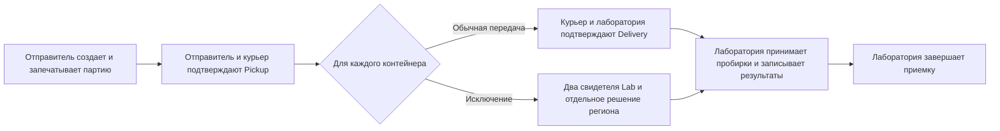
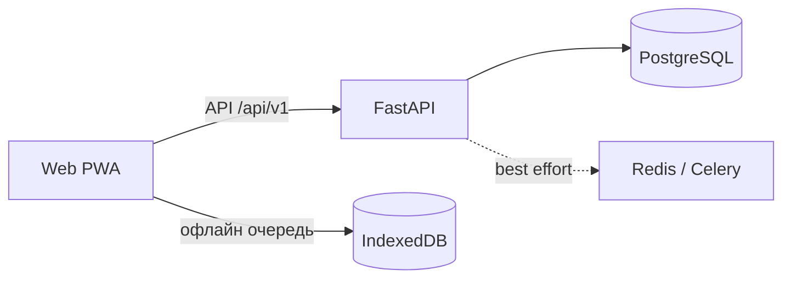

# LabTrack

LabTrack отслеживает передачу лабораторных пробирок от отправителя через курьера до лаборатории — с подтверждениями на каждом этапе.

> **Только синтетические данные.** Свободные ссылки на внешнюю ЛИС могут идентифицировать людей. Не используйте реальные медицинские данные.

**Демо-окружение:** [labtrack.wvzl.site](https://labtrack.wvzl.site) — общий стенд с синтетическими данными; данные и аккаунты могут меняться. Ссылка указывает на окружение, но не обещает его доступность или соответствие текущему коду.

## Рабочий процесс

Pickup относится ко всей партии и требует двух разных участников. Delivery подтверждается отдельно для каждого контейнера. Исключительная приемка требует двух разных сотрудников целевой лаборатории, включая менеджера, и отдельного решения регионального оператора.

## Возможности

- Ролевые рабочие области Sender, Courier, Lab Operator и Lab Manager; полномочия ограничены организацией или регионом.
- Прослеживаемость Shipment → Container → Sample, включая частичную доставку и историю результатов.
- Контроль доступа, идемпотентные команды и аудит изменений.
- Courier PWA с локальной очередью для работы без сети; команда становится системным событием только после проверки и синхронизации с сервером.

| Роль | Зона ответственности |
|---|---|
| Sender | Формирует партию и подтверждает выдачу |
| Courier | Подтверждает Pickup и доставляет контейнеры |
| Lab Operator / Manager | Принимает контейнеры, записывает результаты и закрывает приемку |
| Regional Operations | Рассматривает исключения в своем регионе |

## Технологии

FastAPI modular monolith, PostgreSQL для авторитетного состояния, Redis/Celery для best-effort уведомлений, React/TypeScript/Vite PWA и IndexedDB для очереди курьера.

## Документация

- [Документы проекта](docs/README.md) — навигация и границы требований.
- [Рабочие процессы](docs/workflows.md) — роли и подтверждения передачи.
- [Архитектура](docs/architecture.md) · [Данные и целостность](docs/data-and-integrity.md).
- [Offline-синхронизация](docs/offline-sync.md) · [API](docs/api.md).
- [Локальная разработка](docs/development.md), [Backend](backend/README.md), [Web](web/README.md).

Подробные документы v0.6.1 описывают утвержденные требования. В них отмечено, где текст нормативный, а где поведение реализовано; статическая OpenAPI-схема является черновиком, не полным контрактом runtime API.
