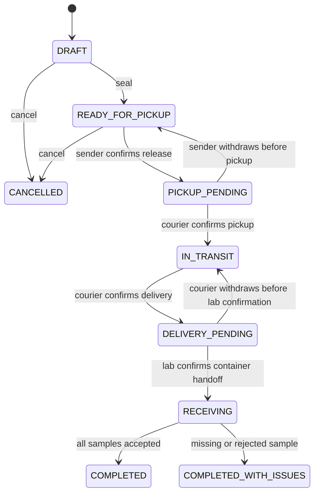

# LabTrack — Domain Model & Workflows

**Версия:** 0.2 (черновик)  
**Назначение:** согласовать модель и жизненный цикл до SQL-моделей и REST-контрактов.

## 1. Принятые решения для MVP

1. **Каждая физическая пробирка — отдельный `Sample`**, имеющий уникальную метку и индивидуальный результат приёмки.
2. **Пробирки объединяются в `TransportContainer`** с собственной меткой. Одна партия (`Shipment`) содержит один или несколько контейнеров; контейнер относится к одной партии.
3. **Каждая передача ответственности подтверждается двумя разными уполномоченными пользователями**: отправитель → курьер и курьер → лаборатория. Подтверждение одной стороны создаёт ожидающую передачу, но не завершает её.
4. **Исключения при поэкземплярной приёмке ограничены `MISSING` (недостача) и `REJECTED` (отказ в приёмке пробирки)**. Повреждения, температурные нарушения, потери контейнеров, возвраты и повторные перевозки в P0 не моделируем как отдельные процессы.
5. Подтверждение получения контейнера лабораторией **не означает**, что каждая пробирка в нём принята. Приёмка содержимого выполняется отдельно.

Под «двухсторонним подтверждением» понимаются аутентифицированные действия в системе, **не** квалифицированная электронная подпись или юридически значимый акт.

## 2. Основные сущности

| Сущность | Назначение | Основные поля (концептуально) |
|---|---|---|
| `Region` | Регион пилотного развертывания | `id`, `name`, `code` |
| `Organization` | Учреждение-отправитель или лаборатория | `id`, `region_id`, `type`, `name`, `is_active` |
| `User` | Учётная запись сотрудника | `id`, `status`, `auth_fields` |
| `Membership` | Роль пользователя в организации | `user_id`, `organization_id`, `role`, `is_active` |
| `Sample` | Одна пробирка/физический образец | `id`, `code`, `origin_organization_id`, `material_type`, `collected_at`, `created_by` |
| `Shipment` | Партия с одним отправителем и одной лабораторией | `id`, `code`, `sender_org_id`, `destination_org_id`, `courier_user_id`, `status`, `version`, `expected_delivery_at` |
| `TransportContainer` | Физический контейнер внутри партии | `id`, `code`, `shipment_id`, `created_at` |
| `ContainerItem` | Связь одной пробирки с контейнером и её результат приёмки | `id`, `container_id`, `sample_id`, `receipt_result`, `receipt_reason`, `received_at` |
| `Handoff` | Два подтверждения передачи ответственности | `id`, `shipment_id`, `kind`, `initiator_user_id`, `receiver_user_id`, `initiated_at`, `confirmed_at`, `status` |
| `ShipmentEvent` | Подтверждённое бизнес-событие | `id`, `shipment_id`, `event_type`, `actor_id`, `occurred_at`, `request_id`, `details` |
| `AuditEvent` | Техническая история значимых операций | `id`, `actor_id`, `entity_type`, `entity_id`, `action`, `occurred_at`, `request_id`, `details` |

Для MVP можно хранить бизнес- и технические события в одном append-only журнале с разными представлениями. `Handoff` хранит состояние согласования; события фиксируют его историю.

## 3. Связи и границы агрегатов

- `Region 1:N Organization`; `User M:N Organization` через `Membership`.
- `Organization 1:N Sample`, по месту первоначальной регистрации.
- `Shipment N:1 Organization` как отправитель и получатель.
- `Shipment 1:N TransportContainer`, минимум один непустой контейнер при seal.
- `TransportContainer 1:N ContainerItem`; `ContainerItem N:1 Sample`.
- `Shipment 1:N Handoff`: в обычном маршруте один `PICKUP` и один `DELIVERY` с подтверждением двух сторон.
- `Shipment 1:N ShipmentEvent`.

`Shipment` — граница синхронизации: изменения контейнеров, их содержимого, handoff и приёмки сериализуются через блокировку партии или контролируемую проверку версии. Перемещение отдельного `Sample` между контейнерами разрешено только до seal. Переупаковка после seal и повторное использование образца в другой партии — вне MVP.

## 4. State machine: Shipment

| Команда | Из состояния | В состояние | Кто подтверждает | Условие |
|---|---|---|---|---|
| `seal` | `DRAFT` | `READY_FOR_PICKUP` | Sender Operator | Назначен курьер, есть ≥1 контейнер и в каждом ≥1 пробирка; манифест зафиксирован |
| `confirm_release` | `READY_FOR_PICKUP` | `PICKUP_PENDING` | Sender Operator | Сверены партия и манифест контейнеров |
| `confirm_pickup` | `PICKUP_PENDING` | `IN_TRANSIT` | Назначенный Courier | Подтверждает тот же манифест; actor отличается от sender |
| `confirm_delivery` | `IN_TRANSIT` | `DELIVERY_PENDING` | Тот же Courier | Идентификаторы контейнеров сверены |
| `confirm_container_receipt` | `DELIVERY_PENDING` | `RECEIVING` | Lab Operator лаборатории назначения | Подтверждает передачу контейнеров; actor отличается от courier |
| `complete_receiving` | `RECEIVING` | `COMPLETED` | Lab Operator | Все пробирки `ACCEPTED` |
| `complete_receiving` | `RECEIVING` | `COMPLETED_WITH_ISSUES` | Lab Operator | Все пробирки обработаны, есть `MISSING` или `REJECTED` |
| `withdraw_release` | `PICKUP_PENDING` | `READY_FOR_PICKUP` | Инициатор отправки | До подтверждения курьером; журналируется |
| `withdraw_delivery` | `DELIVERY_PENDING` | `IN_TRANSIT` | Инициатор доставки | До подтверждения лабораторией; журналируется |
| `cancel` | `DRAFT` / `READY_FOR_PICKUP` | `CANCELLED` | Sender Operator | Причина обязательна; после подтверждения выдачи отмены нет |

После `seal` нельзя менять манифест партии: перечень контейнеров, распределение и состав пробирок. Незавершённый `Handoff` **не** подтверждает переход ответственности. Подтверждения хранят actor и точное время; повторные или конфликтующие подтверждения не создают вторую передачу.

Отзыв первой стороны — штатное управление незавершённым подтверждением, а не логистическое исключение. После закрытия партии изменения результатов запрещены; административное исправление или повторный рейс — вне MVP.

## 5. Результаты приёмки каждой пробирки

`ContainerItem.receipt_result`:

- `null` — не проверена;
- `ACCEPTED` — обнаружена и принята к дальнейшему организационному процессу;
- `MISSING` — числится в зафиксированном манифесте, но отсутствует при приёмке; обязательна причина/комментарий;
- `REJECTED` — физически предъявлена, но сотрудник лаборатории отказал в приёмке; обязательна причина/комментарий.

Каждая пробирка имеет собственный код; сканирование контейнера показывает его ожидаемый состав, **не** отмечая автоматически все пробирки `ACCEPTED`. Лаборатория сканирует каждую пробирку или выбирает её из манифеста, затем явно фиксирует результат. Нельзя завершить приёмку, пока хотя бы один `ContainerItem` имеет `null`.

`ACCEPTED` — только организационная приёмка, не клиническое заключение или автоматическая оценка пригодности к исследованию. В P0 нет отдельной state machine для образцов.

## 6. Инварианты и консистентность

1. `Sample.code`, `TransportContainer.code` и `Shipment.code` уникальны, непредсказуемы и не раскрывают пациента.
2. У партии один отправитель и один получатель; у контейнера только одна партия.
3. Образец принадлежит организации-отправителю партии, в контейнер которой он включён.
4. `UNIQUE(container_items.sample_id)` запрещает включать пробирку в несколько контейнеров/партий, включая конкурентные операции.
5. `ContainerItem` в одной партии меняется только до seal (состав) либо в `RECEIVING` (результат).
6. `seal` требует непустые контейнеры и уникальные позиции; после seal манифест неизменяем.
7. При подтверждении передачи участвуют разные аккаунты с нужными ролями и scope: отправитель + назначенный курьер, затем курьер + лаборатория назначения.
8. `Handoff` подтверждён только после обоих действий. Переход партии и запись события выполняются в одной транзакции.
9. Только лаборатория назначения фиксирует исходы; `MISSING` и `REJECTED` требуют причину, у `MISSING` нет физической приёмки.
10. Финализация допускается только при явном результате для каждой пробирки.
11. При конфликте конкурентных команд успешной становится не более одна актуальная операция; другая получает корректный `409` либо тот же результат при совпадающем idempotency key.
12. Access control проверяется независимо от сложности угадывания ID; региональный аналитик видит агрегаты, не содержимое образцов.

Для команд изменения состава, `seal`, подтверждений и приёмки используем блокировку `shipments` через `SELECT ... FOR UPDATE` либо согласованную CAS-стратегию с `version`. Подтверждение и связанный `ShipmentEvent` сохраняются атомарно. `Idempotency-Key` уникален в scope actor + operation и привязан к хэшу payload; retry не создаёт вторых событий. Асинхронные уведомления не меняют состояние партии.

## 7. Два исключения P0

| Исключение | Условие | Операция | Итог |
|---|---|---|---|
| **Недостача** (`MISSING`) | Пробирка указана в манифесте, но её нет при проверке контейнера | Lab Operator указывает конкретный `ContainerItem` и причину | `COMPLETED_WITH_ISSUES` после обработки всех позиций |
| **Отказ в приёмке** (`REJECTED`) | Пробирка предъявлена лаборатории, но не принимается | Lab Operator указывает конкретный `ContainerItem` и причину | `COMPLETED_WITH_ISSUES` после обработки всех позиций |

Повторное подтверждение, ошибки доступа и конфликты версий — ошибки/защитные механизмы API, не отдельные типы инцидентов. Повреждение, температурное нарушение, задержка как самостоятельный инцидент, отказ от всего контейнера, возврат и повторная перевозка остаются вне P0. Плановую просрочку можно отображать как вычисляемый показатель, без заведения третьего типа исключения.

## 8. Неутверждённые вопросы

- Кто назначает курьера: отправитель или диспетчер?
- Какой перечень кодов причин `MISSING` / `REJECTED` нужен для демо?
- Разрешать ли нескольким Lab Operator одновременно отмечать позиции (при сериализации по партии)?
- Какие справочники материалов и сроки перевозки нужны без моделирования медицинских нормативов?

Выбранные решения и их последствия зафиксированы также в [Decision Log](05-design-decisions.md).
