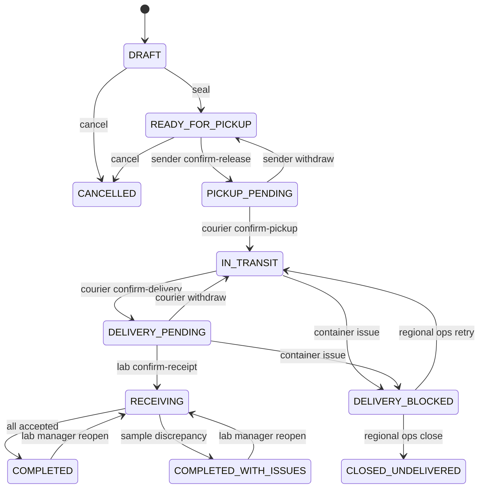

# LabTrack — Domain Model & Workflows

> **Исторический документ (до v0.6).** Здесь могут встречаться устаревшие правила передачи всей партии, одностороннего разрешения контейнерных проблем и old API paths. Актуальные и приоритетные требования: [Decisions v0.6](15-decisions-v06.md), [Domain v0.6](16-domain-workflows-v06.md), [Data Model v0.6](17-data-model-v06.md), [API v0.6](18-api-v06.md). Не использовать этот документ в одиночку как нормативный контракт.

**Версия:** 0.5 (целевые доменные правила)  
**Назначение:** согласовать модель и жизненный цикл до SQL-моделей и REST-контрактов.

## 1. Принятые решения для MVP

1. **Каждая физическая пробирка — отдельный `Sample`**, имеющий уникальную метку и индивидуальный результат приёмки.
2. **Пробирки объединяются в `TransportContainer`** с собственной меткой. Одна партия (`Shipment`) содержит один или несколько контейнеров; контейнер относится к одной партии.
3. **Каждая передача ответственности подтверждается двумя разными уполномоченными пользователями**: отправитель → курьер и курьер → лаборатория. Подтверждение одной стороны создаёт ожидающую передачу, но не завершает её.
4. **Категории исключений только `MISSING` и `REJECTED`**, но применяются к пробирке или контейнеру. Контейнерная проблема блокирует всю доставку.
5. Подтверждение контейнера не означает приёмку пробирок: каждая проверяется отдельно.
6. LAB_MANAGER может повторно открыть завершённую приёмку с аудитом. Offline Courier queue не меняет сервер до sync.

Под «двухсторонним подтверждением» понимаются аутентифицированные действия в системе, **не** квалифицированная электронная подпись или юридически значимый акт.

## 2. Основные сущности

| Сущность | Назначение | Основные поля (концептуально) |
|---|---|---|
| `Region` | Регион пилотного развертывания | `id`, `name`, `code` |
| `Organization` | Учреждение-отправитель или лаборатория | `id`, `region_id`, `type`, `name`, `is_active` |
| `User` | Учётная запись сотрудника | `id`, `status`, `auth_fields` |
| `Membership` | Роль пользователя в организации | `user_id`, `organization_id`, `role`, `is_active` |
| `Sample` | Одна пробирка/физический образец | `id`, `code`, `origin_organization_id`, `material_type`, `collected_at`, `created_by` |
| `Shipment` | Партия с одним отправителем и одной лабораторией | `id`, `code`, `sender_org_id`, `destination_org_id`, `courier_user_id`, `status`, `version`, `expected_delivery_at` |
| `TransportContainer` | Физический контейнер внутри партии | `id`, `code`, `shipment_id`, `created_at` |
| `ContainerItem` | Связь одной пробирки с контейнером и её результат приёмки | `id`, `container_id`, `sample_id`, `receipt_result`, `receipt_reason`, `received_at` |
| `Handoff` | Два подтверждения передачи ответственности | `id`, `shipment_id`, `kind`, `initiator_user_id`, `receiver_user_id`, `initiated_at`, `confirmed_at`, `status` |
| `ContainerIssue` | Проблема контейнера MISSING/REJECTED | `id`, `container_id`, `kind`, `reason_code_id`, `status` |
| `ReceivingSession` | Контроль reopening | `id`, `shipment_id`, `sequence`, `status` |
| `ReceiptRevision` | Immutable history sample results | `id`, `container_item_id`, `old_result`, `new_result` |
| `IssueReasonCode` | Code catalog by scope/kind | `id`, `scope`, `kind`, `code` |
| `SampleExternalReference` | Opaque synthetic LIS reference | `id`, `sample_id`, `system_code`, `external_id` |
| `ShipmentEvent` | Подтверждённое бизнес-событие | `id`, `shipment_id`, `event_type`, `actor_id`, `occurred_at`, `request_id`, `details` |
| `AuditEvent` | Техническая история значимых операций | `id`, `actor_id`, `entity_type`, `entity_id`, `action`, `occurred_at`, `request_id`, `details` |

Для MVP можно хранить бизнес- и технические события в одном append-only журнале с разными представлениями. `Handoff` хранит состояние согласования; события фиксируют его историю.

## 3. Связи и границы агрегатов

- `Region 1:N Organization`; `User M:N Organization` через `Membership`.
- `Organization 1:N Sample`, по месту первоначальной регистрации.
- `Shipment N:1 Organization` как отправитель и получатель.
- `Shipment 1:N TransportContainer`, минимум один непустой контейнер при seal.
- `TransportContainer 1:N ContainerItem`; `ContainerItem N:1 Sample`.
- `Shipment 1:N Handoff`: в обычном маршруте один `PICKUP` и один `DELIVERY` с подтверждением двух сторон.
- `Shipment 1:N ShipmentEvent`.

`Shipment` — граница синхронизации: изменения контейнеров, их содержимого, handoff и приёмки сериализуются через блокировку партии или контролируемую проверку версии. Перемещение отдельного `Sample` между контейнерами разрешено только до seal. Переупаковка после seal и повторное использование образца в другой партии — вне MVP.

## 4. State machine: Shipment (v0.5)

Каждая передача завершается только после отдельных подтверждений двух разных сотрудников. Если контейнер отсутствует или отклонён, доставка всей партии блокируется, pending Delivery Handoff отзывается и создаётся `ContainerIssue`. При ручном разрешении региональный ответственный выбирает RETRY_DELIVERY или CLOSE_UNDELIVERED; детские результаты пробирок не меняются автоматически.

LAB_MANAGER может повторно открыть завершённую приёмку с причиной, новой receiving session и append-only revisions. Состав запечатанного контейнера неизменяем. До успешной синхронизации Offline Courier действие считается только локально ожидающим.

## 5. Результаты приёмки каждой пробирки

`ContainerItem.receipt_result`:

- `null` — не проверена;
- `ACCEPTED` — обнаружена и принята к дальнейшему организационному процессу;
- `MISSING` — числится в зафиксированном манифесте, но отсутствует при приёмке; обязательна причина/комментарий;
- `REJECTED` — физически предъявлена, но сотрудник лаборатории отказал в приёмке; обязательна причина/комментарий.

Каждая пробирка имеет собственный код; сканирование контейнера показывает его ожидаемый состав, **не** отмечая автоматически все пробирки `ACCEPTED`. Лаборатория сканирует каждую пробирку или выбирает её из манифеста, затем явно фиксирует результат. Нельзя завершить приёмку, пока хотя бы один `ContainerItem` имеет `null`.

`ACCEPTED` — только организационная приёмка, не клиническое заключение или автоматическая оценка пригодности к исследованию. В P0 нет отдельной state machine для образцов.

## 6. Инварианты и консистентность

1. `Sample.code`, `TransportContainer.code` и `Shipment.code` уникальны, непредсказуемы и не раскрывают пациента.
2. У партии один отправитель и один получатель; у контейнера только одна партия.
3. Образец принадлежит организации-отправителю партии, в контейнер которой он включён.
4. `UNIQUE(container_items.sample_id)` запрещает включать пробирку в несколько контейнеров/партий, включая конкурентные операции.
5. `ContainerItem` в одной партии меняется только до seal (состав) либо в `RECEIVING` (результат).
6. `seal` требует непустые контейнеры и уникальные позиции; после seal манифест неизменяем.
7. При подтверждении передачи участвуют разные аккаунты с нужными ролями и scope: отправитель + назначенный курьер, затем курьер + лаборатория назначения.
8. `Handoff` подтверждён только после обоих действий. Переход партии и запись события выполняются в одной транзакции.
9. Только лаборатория назначения фиксирует исходы; `MISSING` и `REJECTED` требуют причину, у `MISSING` нет физической приёмки.
10. Финализация допускается только при явном результате для каждой пробирки.
11. При конфликте конкурентных команд успешной становится не более одна актуальная операция; другая получает корректный `409` либо тот же результат при совпадающем idempotency key.
12. Access control проверяется независимо от сложности угадывания ID; региональный аналитик видит агрегаты, не содержимое образцов.

Для команд изменения состава, `seal`, подтверждений и приёмки используем блокировку `shipments` через `SELECT ... FOR UPDATE` либо согласованную CAS-стратегию с `version`. Подтверждение и связанный `ShipmentEvent` сохраняются атомарно. `Idempotency-Key` уникален в scope actor + operation и привязан к хэшу payload; retry не создаёт вторых событий. Асинхронные уведомления не меняют состояние партии.

## 7. Два вида исключений P0 — два уровня

| Kind | Target | Результат |
|---|---|---|
| MISSING | SAMPLE | Пробирка не найдена при receiving |
| REJECTED | SAMPLE | Лаборатория отказала в приёмке предъявленной пробирки |
| MISSING | CONTAINER | Контейнер отсутствует, вся доставка DELIVERY_BLOCKED |
| REJECTED | CONTAINER | Контейнер отклонён лабораторией, вся доставка DELIVERY_BLOCKED |

Для исключений нужен `reason_code` из справочника с подходящим scope+kind; комментарий необязателен. Отказ в целом контейнере не устанавливает результат пробирок и не приводит к успешной частичной передаче.

## 8. Открытые операционные вопросы

- Фактическая ответственность за заблокированный/отклонённый контейнер до ручного разрешения.
- Максимальная длительность offline очереди до операционного review.
- Конкретный каталог причин, типы внешних LIS ссылок и юридическая семантика времени offline-событий.
- Нужен ли срок, после которого reopening приёмки уже запрещено.

Назначение Courier — Sender в DRAFT; в пилоте одна центральная Lab. См. [v0.5 Decision Register](10-domain-hardening-v05.md).

## Следующий уровень спецификации

- [PostgreSQL Data Model & ERD](06-data-model.md) — физические таблицы и гарантии БД.
- [Workflows, Transactions & Concurrency](07-transactions-and-concurrency.md) — команды, транзакционные границы, блокировки, idempotency и тестовая матрица.

- [DB Delta v0.5](12-data-model-v05.md) — новые поля, triggers, receiving revisions.
- [Offline Courier](11-offline-sync-protocol.md) — синхронизация pending команд.
