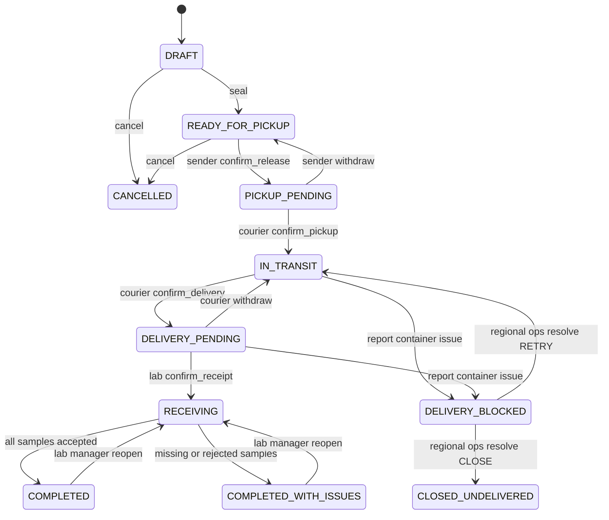

# LabTrack v0.5 — Реестр решений и доменные правила

> **Исторический документ (до v0.6).** Здесь могут встречаться устаревшие правила передачи всей партии, одностороннего разрешения контейнерных проблем и устаревшие пути API. Актуальные и приоритетные требования: [Решения v0.6](15-decisions-v06.md), [Доменная модель v0.6](16-domain-workflows-v06.md), [Модель данных v0.6](17-data-model-v06.md), [API v0.6](18-api-v06.md). Не использовать этот документ в одиночку как нормативный контракт.

**Статус:** продуктовые решения по заполненному опроснику и явно сформулированные архитектурные предложения.
**Приоритет:** для v0.5 этот документ заменяет противоречащие ему положения v0.1–v0.4. Машиночитаемый API и ранние документы необходимо привести в соответствие до реализации.

## 1. Утверждённые продуктовые решения (20/20)

| ID | Решение |
|---|---|
| V05-01 | Одна центральная принимающая лаборатория в пилотном регионе; у каждой партии один отправитель и этот настроенный получатель |
| V05-02 | Оператор отправителя назначает курьера; замена возможна только в DRAFT |
| V05-03 | Организации и начальные пользователи создаются через CLI начальной настройки; администратор организации управляет членством и ролями |
| V05-04 | REJECTED может относиться к отдельному Sample **или** целому TransportContainer |
| V05-05 | Если контейнер отсутствует, не подтверждать доставку; передать на ручное разрешение |
| V05-06 | О зависших ожидающих передачах уведомляют ответственного сотрудника или передают ему вопрос; автоматическое подтверждение запрещено |
| V05-07 | Отмена Shipment не освобождает привязанные Sample; повторная отправка за рамками продукта |
| V05-08 | Оператор лаборатории может исправить результат приёмки Sample до завершения; каждое исправление сопровождается событием аудита |
| V05-09 | Руководитель лаборатории может повторно открыть завершённую приёмку с причиной и аудитом |
| V05-10 | MISSING/REJECTED требует структурированного кода причины; свободный комментарий необязателен |
| V05-11 | При приёмке Sample допустимы QR или ручной выбор из манифеста; каждая позиция получает явный результат |
| V05-12 | Образцы могут содержать непрозрачные ссылки на внешние объекты ЛИС; данные пациентов и реальная интеграция с ЛИС отсутствуют |
| V05-13 | Локальная аутентификация использует Argon2id и короткоживущий JWT |
| V05-14 | Демонстрационный аудит не удаляется автоматически; реальная политика хранения остаётся отдельным эксплуатационным решением |
| V05-15 | Триггеры БД защищают запечатанный манифест в дополнение к проверкам сервиса |
| V05-16 | Отправитель вручную задаёт expected_delivery_at |
| V05-17 | Уведомления Celery/Redis доставляются без гарантий и никогда не служат источником истины |
| V05-18 | Курьер поддерживает очередь команд без сети с последующей синхронизацией |
| V05-19 | Цель — MVP, приближенный к эксплуатации, с тестами, CI и наблюдаемостью, на синтетических данных |

Подсчёт: V05-01–V05-19 содержат 20 ответов, поскольку V05-02 охватывает назначение и замену курьера. Сохранены решения предыдущих итераций: отдельное отслеживание каждой пробирки внутри контейнера, двусторонние передачи и только две категории расхождений MISSING/REJECTED.

## 2. Разделение категории проблемы и её объекта

*Категория расхождения* — MISSING или REJECTED. *Объект* — SAMPLE или CONTAINER.

| Объект | MISSING | REJECTED |
|---|---|---|
| Пробирка | Ожидается по манифесту, но не найдена при приёмке | Предъявлена, но лаборатория отказала в приёмке |
| Контейнер | Ожидается при доставке, но не предъявлен | Предъявлен, но лаборатория назначения отказала в приёмке |

**Проектное решение v0.5:** `container_issues` — достоверное хранилище проблем CONTAINER, а существующее `container_items.receipt_result` сохраняет эту роль для проблем SAMPLE. **Не дублировать результаты пробирок в универсальной таблице проблем**. Коды причин общие для обоих уровней. Аналитика может объединять оба источника запросами.

Проблема контейнера **никогда** автоматически не меняет результаты дочерних пробирок. Полная приёмка контейнера невозможна при неразрешённой проблеме доставки. Частичная передача остальных контейнеров в MVP отсутствует.

## 3. Автомат состояний партии (предлагаемое расширение v0.5)

`DELIVERY_BLOCKED` и `CLOSED_UNDELIVERED` — **состояния процесса Shipment**, а не новые категории расхождений.

**Правила заблокированной доставки:**

1. Только курьер с подходящей областью доступа или оператор лаборатории назначения может сообщить о фактическом расхождении при доставке контейнера из запечатанного манифеста. Об отсутствии может сообщить любая сторона; для REJECTED требуется оператор лаборатории назначения.
2. Сообщение из IN_TRANSIT или DELIVERY_PENDING атомарно открывает `container_issue` и переводит Shipment в DELIVERY_BLOCKED.
3. Если передача DELIVERY имеет статус PENDING, он меняется на WITHDRAWN с записью аудита; прежний инициатор и обе временные метки сохраняются в истории.
4. Контейнер и все дочерние позиции остаются частью исходного запечатанного манифеста. Результаты `ACCEPTED`, `MISSING` и `REJECTED` не назначаются пробиркам автоматически.
5. Пользователь `REGIONAL_OPERATIONS` с подходящей областью доступа явно разрешает блокировку с причиной и одним из исходов:
   - `RETRY_DELIVERY`: отметить проблему разрешённой для повторной попытки; перейти в IN_TRANSIT; требуется новая попытка передачи при доставке.
   - `CLOSE_UNDELIVERED`: закрыть проблему как недоставку, а Shipment — как CLOSED_UNDELIVERED; сеанс приёмки не создаётся.
6. Разрешение проблемы и итоговое состояние фиксируются одной транзакцией, с исполнителем и причиной в журнале. При повторной попытке или закрытии у партии не должно оставаться неучтённых проблем контейнеров OPEN.

**Предположение о физической ответственности — не утверждено опросником:** пока доставка заблокирована, курьер отвечает за контейнеры до отдельной утверждённой передачи или ручного закрытия. Это не доказывает физическое местоположение контейнера. Правовые и операционные правила необходимо согласовать до реального использования.

## 4. Приёмка и повторное открытие

- LAB_OPERATOR или LAB_MANAGER лаборатории назначения фиксирует результат каждой позиции в RECEIVING; у `ACCEPTED` нет кода причины; `MISSING` / `REJECTED` требуют кода, допустимого для `scope=SAMPLE` и соответствующей категории.
- Лаборатория может исправить позицию до завершения, **создав версию результата приёмки и неизменяемое событие аудита**.
- При первом подтверждении доставки лабораторией создать `receiving_session(sequence=1,status=OPEN)`. При завершении закрыть сеанс и вывести статус Shipment из последних результатов пробирок.
- `LAB_MANAGER` может повторно открыть Shipment только из COMPLETED или COMPLETED_WITH_ISSUES. Требуются непустая причина и **новый сеанс приёмки** с сохранением всех прежних сеансов, версий изменений и аудита. Shipment возвращается в RECEIVING. Запечатанный манифест не меняется.
- При повторном открытии прежние результаты пробирок остаются **текущими**, без автоматического сброса; оператор может исправить выбранные позиции. При следующем завершении заново проверить все позиции и вычислить статус. Допустим только один сеанс OPEN на Shipment.
- Повторное открытие CLOSED_UNDELIVERED в MVP отсутствует. Руководитель лаборатории не может переопределить ответственность за отсутствующий контейнер.

## 5. Двусторонние передачи и работа без сети

Забор: отправитель подтверждает выдачу через сеть, затем курьер подтверждает получение. Доставка: курьер подтверждает доставку, затем лаборатория подтверждает получение контейнеров. Требуются разные исполнители и проверенные роли, в том числе при синхронизации действий без сети.

**Действия без сети — клиентские черновики, а не подтверждённые сервером события ответственности.** До успешной синхронизации локально показывается `PENDING_SYNC`; серверный статус Shipment не меняется. При синхронизации проверяются текущий исполнитель, роль, манифест, состояние, дубли и переданный набор контейнеров. Временные метки устройства — недоверенные метаданные; серверная метка — достоверное время регистрации подтверждения.

Ручная передача просроченных или зависших передач ответственному сотруднику относится к P0, но может лишь запросить проверку человеком и не должна незаметно завершать передачи. Уведомления не гарантированы; устаревшие случаи должны находиться через панель показателей, даже если все уведомления потеряны.

См. [Протокол синхронизации действий без сети](11-offline-sync-protocol.md).

## 6. Роли и области доступа

- `SENDER_OPERATOR`: создаёт пробирки, контейнеры и партию, назначает курьера в DRAFT, запечатывает, начинает забор, отменяет до начала забора.
- `COURIER`: только назначенные партии; подтверждает забор, начинает доставку, сообщает об отсутствии контейнера, синхронизирует разрешённые команды без сети.
- `LAB_OPERATOR`: лаборатория назначения подтверждает получение контейнеров, фиксирует и исправляет результаты пробирок, сообщает о MISSING/REJECTED контейнеров.
- `LAB_MANAGER`: руководящая роль лаборатории назначения; дополнительно повторно открывает завершённую приёмку с аудитом.
- `ORG_ADMIN`: управляет членством в своей организации; не получает неявного права обходить медицинские и операционные правила.
- `REGIONAL_OPERATIONS`: вручную разрешает блокировки и рассматривает переданные вопросы в своём регионе; не имеет общих полномочий редактировать результаты отдельных пробирок или пользователей.
- `REGIONAL_ANALYST`: только чтение региональных агрегатов, без построчных данных пробирок.

Начальная настройка создаёт все необходимые исходные учётные записи и записи регионов/организаций; публичного API регистрации пользователей нет.

## 7. Открытые вопросы: не превращать предложения по умолчанию в утверждённые требования

| Вопрос | Рабочее предложение | Требует подтверждения |
|---|---|---|
| Фактическая ответственность за отклонённый контейнер | Остаётся у курьера до утверждённой передачи/ручного закрытия | Да, операционными специалистами |
| Кто именно рассматривает переданные вопросы | REGIONAL_OPERATIONS своего региона | Роль подтверждена владельцем продукта |
| Длительность хранения локальных команд без сети | Предлагаемый порог ручной проверки — 24 часа, без автоматического принятия или истечения срока | Да |
| Период повторного открытия | Без автоматического срока в синтетическом MVP; LAB_MANAGER с причиной | Да |
| Справочник кодов причин | Начальное заполнение стабильными техническими кодами по SAMPLE/CONTAINER, MISSING/REJECTED | Конкретные имена кодов |
| Кратность внешних ссылок ЛИС | `Sample 1:N external_reference`, чтобы не предполагать один анализ на пробирку | Да |
| Время физической передачи | `client_performed_at` недоверенное, `recorded_at` — часы серверной БД | Фактический правовой смысл |
| Весь контейнер пропал в пути | Сообщить и заблокировать доставку, не помечать ложно все пробирки MISSING | Да, согласуется с отсутствием частичной передачи |

В документации явно различаются **утверждённые решения** и **предлагаемые параметры реализации по умолчанию**. Это не позволяет неоднозначным операционным решениям стать неявными ограничениями БД.
