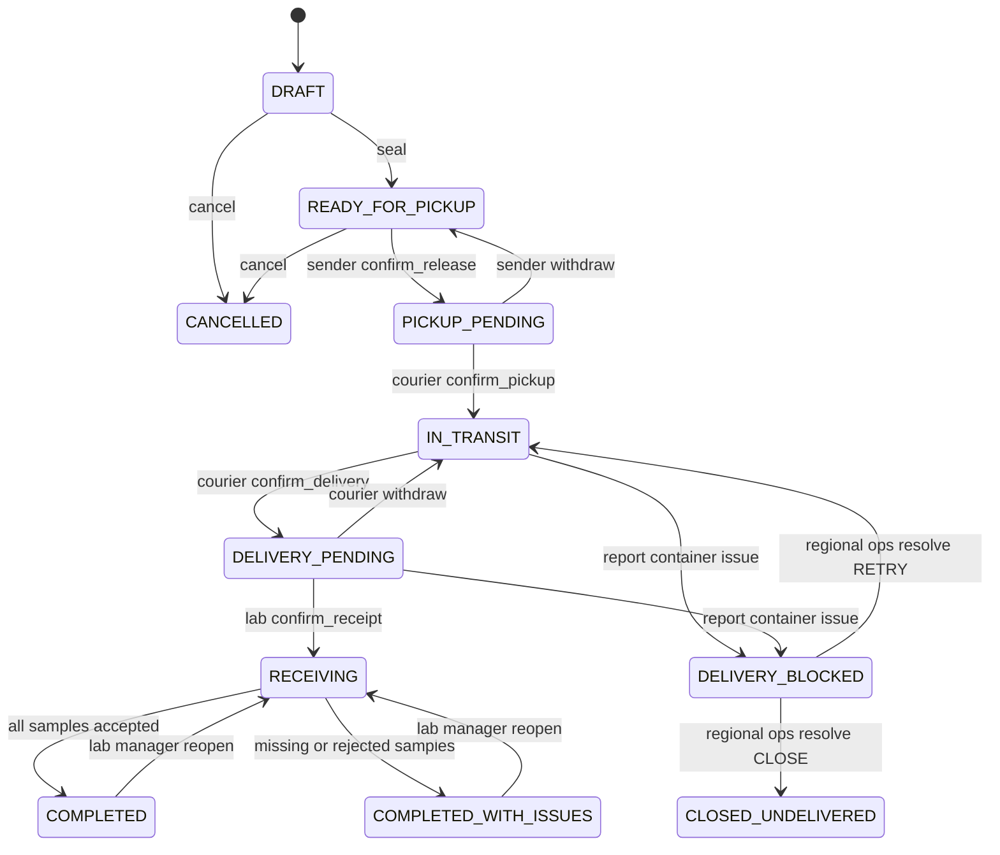

# LabTrack v0.5 — Decision Register & Domain Rules

> **Исторический документ (до v0.6).** Здесь могут встречаться устаревшие правила передачи всей партии, одностороннего разрешения контейнерных проблем и old API paths. Актуальные и приоритетные требования: [Decisions v0.6](15-decisions-v06.md), [Domain v0.6](16-domain-workflows-v06.md), [Data Model v0.6](17-data-model-v06.md), [API v0.6](18-api-v06.md). Не использовать этот документ в одиночку как нормативный контракт.

**Status:** product decisions from the completed questionnaire + explicit architecture proposals.  
**Precedence:** for v0.5, this document overrides contradictory statements in v0.1–v0.4. Machine-readable API and earlier docs must be updated to match before implementation.

## 1. Approved product choices (20/20)

| ID | Decision |
|---|---|
| V05-01 | One central receiving laboratory in the pilot region; each Shipment has one sender and that configured destination |
| V05-02 | Sender Operator assigns the Courier; replacement only in DRAFT |
| V05-03 | Organizations and initial users are created by bootstrap CLI; Org Admin manages membership/roles |
| V05-04 | REJECTED can refer to an individual Sample **or** an entire TransportContainer |
| V05-05 | If a container is missing, do not confirm Delivery; route to manual resolution |
| V05-06 | Stuck pending handoffs are notified/escalated to a responsible human, never auto-confirmed |
| V05-07 | Cancelling a Shipment does not release its Sample allocations; repeat shipping is out of scope |
| V05-08 | Lab Operator may correct a Sample receipt before finalization; each correction has a recorded audit event |
| V05-09 | Lab Manager may reopen completed receiving with a reason and audit |
| V05-10 | MISSING/REJECTED requires a structured reason code; free-text comment is optional |
| V05-11 | Sample receiving can use QR or manual manifest selection; every item receives an explicit outcome |
| V05-12 | Samples may hold opaque references to external LIS objects; no patient data or actual LIS integration |
| V05-13 | Local auth uses Argon2id and short-lived JWT |
| V05-14 | Demo audit is not automatically deleted; real retention policy remains a separate production decision |
| V05-15 | DB triggers protect the sealed manifest in addition to service-level checks |
| V05-16 | Sender manually sets expected_delivery_at |
| V05-17 | Celery/Redis notifications are best-effort, never the source of truth |
| V05-18 | Courier supports an offline command queue with later synchronization |
| V05-19 | Target is a production-like MVP with tests, CI and observability, using synthetic data |

Count: V05-01–V05-19 contain 20 answers because V05-02 covers both courier assignment and replacement. Decisions retained from previous iterations: each tube tracked separately inside a container, two-party handoffs, and only the two discrepancy categories MISSING/REJECTED.

## 2. Conceptual separation of problem kind and target

A *discrepancy kind* is MISSING or REJECTED. A *target* is SAMPLE or CONTAINER.

| Target | MISSING | REJECTED |
|---|---|---|
| Sample | Sample expected in manifest but not found during receiving | Sample presented but refused by laboratory |
| Container | Container expected at delivery but not presented | Container presented but refused by destination laboratory |

**v0.5 design choice:** use `container_issues` as the authoritative store for CONTAINER problems, while existing `container_items.receipt_result` remains authoritative for SAMPLE problems. **Do not duplicate sample outcomes in a generic issues table**. Reason codes are shared across levels. Analytics may combine both sources by querying them.

A container issue **never** automatically changes results of its child samples. Full container acceptance does not occur while it has an unresolved delivery issue. There is no partial handoff of the other containers in MVP.

## 3. Shipment state machine (proposed v0.5 extension)

`DELIVERY_BLOCKED` and `CLOSED_UNDELIVERED` are **Shipment workflow states**, not new discrepancy types.

**Rules for a blocked delivery:**

1. Only a scoped Courier or destination Lab Operator can report an actual delivery discrepancy for a container in the sealed manifest. Missing container can be reported by either party; container REJECTED requires destination Lab Operator.
2. A report from IN_TRANSIT or DELIVERY_PENDING opens a `container_issue` and changes the Shipment to DELIVERY_BLOCKED atomically.
3. If a DELIVERY handoff is PENDING, it becomes WITHDRAWN with an audit entry; the prior initiator and both timestamps remain in the history.
4. The container and all child items remain part of the original sealed manifest. No `ACCEPTED`, `MISSING` or `REJECTED` outcomes are assigned automatically to samples.
5. A scoped `REGIONAL_OPERATIONS` user explicitly resolves a blocked delivery, with a reason and one of:
   - `RETRY_DELIVERY`: mark the issue resolved for retry; transition to IN_TRANSIT; a new delivery handoff attempt is required.
   - `CLOSE_UNDELIVERED`: close the issue as undelivered and Shipment as CLOSED_UNDELIVERED; no receiving session is created.
6. Completion of any issue resolution and resulting state is a single transaction, logged with actor and reason. A shipment cannot have unaccounted-for OPEN container issues at retry or closure.

**Physical custody assumption — not approved by questionnaire:** while delivery is blocked, the courier remains responsible for the containers until a separate approved handoff or manual closure. Do not claim this proves where the container physically is. Legal/operational policy must be agreed before real-world use.

## 4. Receiving and reopening

- LAB_OPERATOR or LAB_MANAGER at destination records per-item result during RECEIVING; `ACCEPTED` has no reason code; `MISSING` / `REJECTED` require a reason code valid for `scope=SAMPLE` and corresponding kind.
- A laboratory may correct an item prior to completion, **writing a receipt revision and append-only audit event**.
- When Lab first confirms Delivery, create `receiving_session(sequence=1,status=OPEN)`. On completion close that session and derive Shipment status from latest per-sample outcomes.
- `LAB_MANAGER` can reopen a Shipment only from COMPLETED or COMPLETED_WITH_ISSUES. Require a nonempty reason and create a **new receiving session**, preserving all prior sessions/revisions/audit. Shipment returns to RECEIVING. No modification to the sealed manifest.
- On reopening, previously recorded sample outcomes remain the **current** values, not automatically reset; operator may revise selected items. On the next completion, re-check all items and re-derive status. Only one OPEN receiving session per Shipment is allowed.
- No reopening of CLOSED_UNDELIVERED in MVP. A lab manager cannot override missing container custody.

## 5. Two-party handoffs and offline

Pickup: Sender confirms release online, then Courier confirms receipt. Delivery: Courier confirms delivery, then Lab confirms container receipt. Separate actors and verified roles required, even when offline actions are synchronized.

**Offline actions are client drafts, not server-confirmed custody events.** Until sync succeeds, show `PENDING_SYNC` locally; server Shipment status is unchanged. Sync must check current actor, current role, manifest, state, duplicates and submitted container set. Device timestamps are untrusted metadata; server timestamp is the authoritative recorded confirmation time.

Manual escalation of overdue or stuck handoffs is P0, but it may only request human review, not silently finalize transfers. Notifications remain best effort; stale cases must also be queryable through the Dashboard even if all notifications fail.

See [Offline Sync Protocol](11-offline-sync-protocol.md).

## 6. Roles and scope

- `SENDER_OPERATOR`: create tubes, containers, shipment, assign Courier in DRAFT, seal, initiate Pickup, cancel before Pickup starts.
- `COURIER`: only assigned shipments; confirm Pickup, initiate Delivery, report missing container, sync authorized offline commands.
- `LAB_OPERATOR`: destination lab confirms receipt of containers, records and corrects sample outcomes, reports container MISSING/REJECTED.
- `LAB_MANAGER`: destination lab supervisory role; also can reopen completed receiving, with audit.
- `ORG_ADMIN`: membership management within own organization, not an implicit medical-operational override.
- `REGIONAL_OPERATIONS`: region-scoped manual resolution of blocked deliveries and escalation review; no general authority to edit individual sample results or users.
- `REGIONAL_ANALYST`: region-scoped aggregate read only, no row-level sample data.

Bootstrap creates all necessary starter accounts and region/org records; no public user-registration API.

## 7. Still open: do not silently promote defaults to approved requirements

| Item | Working proposal | Needs confirmation |
|---|---|---|
| Actual physical custody of rejected container | Remains with Courier pending approved handoff/manual closure | Yes, operational specialists |
| Who specifically may handle escalation | Region-scoped REGIONAL_OPERATIONS | Role confirmed by product owner |
| Duration of locally queued offline actions | 24-hour suggested threshold for manual review, not automatic acceptance/expiry | Yes |
| Reopening window | No automatic deadline in synthetic MVP; LAB_MANAGER with reason | Yes |
| Reason code catalog | Seed stable technical codes grouped by SAMPLE/CONTAINER, MISSING/REJECTED | Actual code names |
| External LIS reference cardinality | `Sample 1:N external_reference` to avoid assuming one analysis per tube | Yes |
| Timestamp for physical handoff | `client_performed_at` is untrusted, `recorded_at` is server DB clock | Actual legal semantics |
| Entire container missing while in transit | Report and block delivery rather than falsely mark all samples MISSING | Yes, aligned with no partial handoff |

In this documentation, **accepted choices** and **proposed implementation defaults** are deliberately distinct. This prevents ambiguous operational decisions from becoming implicit DB constraints.
