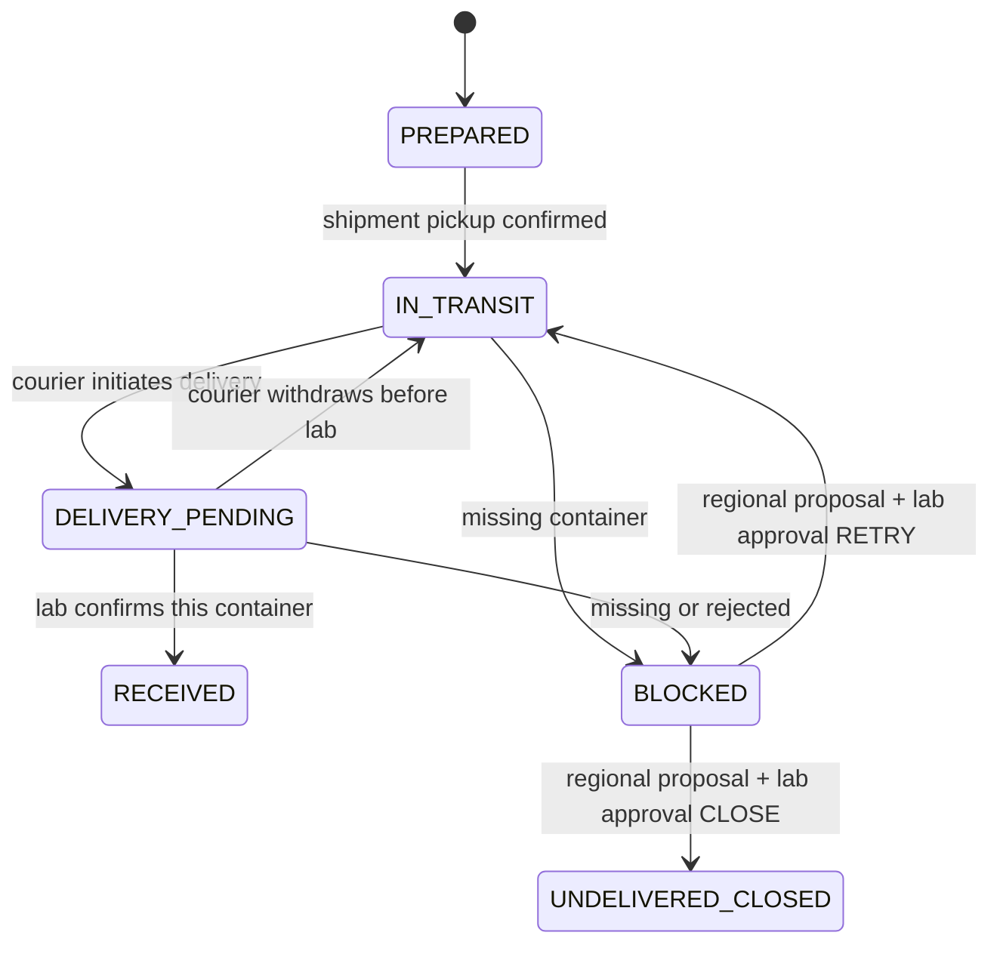
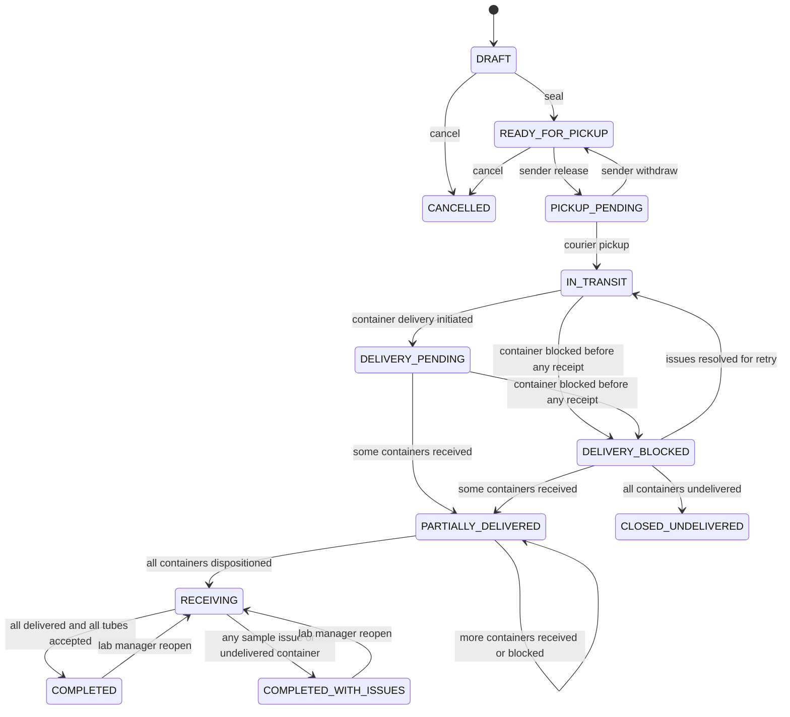

# LabTrack v0.6 — Shipment, Container, Custody and Receiving State Machines

> **Исторический базовый документ v0.6.** v0.6.1 supersedes contradictory requirements; current decisions and API are in [Decision Register v0.6.1](20-decisions-v061.md), [Custody Exceptions](21-custody-exceptions-v061.md), [Offline Integrity](22-offline-integrity-v061.md), [DB Delta](23-data-model-v061.md), [API](24-api-and-operations-v061.md). Keep v0.6 rules only where unchanged.

**Normative workflow specification.** See [Decision Register](15-decisions-v06.md) for what was user-approved and which technical policies are derived. All data synthetic; no legal signing or clinical acceptability decisions.

## 1. Aggregate boundaries

A Shipment groups one or more sealed TransportContainers, each containing one or more Sample items. **Shipment is the transaction/locking aggregate**, but **Delivery custody is per TransportContainer**; no per-container operation skips the parent lock.

- **Pickup:** one Shipment-level bilateral handoff. Sender confirms release → `PICKUP_PENDING`; assigned Courier checks the complete sealed set and confirms pickup → all Shipment containers become `IN_TRANSIT`. Distinct actors. Courier reassignment after DRAFT forbidden.
- **Delivery:** one bilateral handoff **per container**. Courier initiates delivery of C-001 → C-001 `DELIVERY_PENDING`. Destination Lab Operator confirms receipt of C-001 → C-001 `RECEIVED`. C-002 may remain `IN_TRANSIT` or `BLOCKED`. Distinct actors for each container handoff; same actor may participate in multiple containers.
- **Tube receiving:** Lab may mark a tube only if **its own parent container is `RECEIVED` with a confirmed two-party delivery handoff**. Scan/manual selection. Cannot receive items belonging to a container still in transit, pending, blocked or closed undelivered.

Manifest identities (Shipment → containers → items) remain unchanged after seal even when per-container delivery status or tube outcomes evolve.

## 2. TransportContainer.delivery_status

| State | Meaning | Allowed transition |
|---|---|---|
| `PREPARED` | Packed before Courier's confirmed pickup | → IN_TRANSIT on completed Pickup |
| `IN_TRANSIT` | Courier holds custody as recorded by system | → DELIVERY_PENDING (Courier initiation), → BLOCKED (MISSING report) |
| `DELIVERY_PENDING` | Courier initiated this container's Delivery; Lab has not confirmed | → RECEIVED (Lab confirmation), → IN_TRANSIT (Courier withdraw), → BLOCKED (MISSING or REJECTED report) |
| `RECEIVED` | Two different actors confirmed delivery for **this container**; lab has custody | No further delivery transitions in MVP; tubes can be received |
| `BLOCKED` | Container missing/refused; no accepted delivery | → IN_TRANSIT after **approved** RETRY_DELIVERY; → UNDELIVERED_CLOSED after **approved** CLOSE_UNDELIVERED |
| `UNDELIVERED_CLOSED` | Regional+Lab manually closed without successful delivery | Terminal, tube results remain NULL |

REJECTED container is a Lab-side decision and should be raised while `DELIVERY_PENDING`; MISSING container may be raised from `IN_TRANSIT` or `DELIVERY_PENDING` by scoped Courier/Lab. Keep refusal separate from refusing a tube during a successfully received container's internal inspection.

When a PENDING delivery handoff is interrupted by BLOCKED, it becomes WITHDRAWN (with actor, reason, event); subsequent RETRY creates a new attempt number for that container. A CONFIRMED handoff can never be withdrawn.

### Per-container handoff (simplified)

## 3. Shipment.status (coarse aggregate progress)

The Shipment status is **not** the sole source of individual container custody. Always use `TransportContainer.delivery_status` for access to tube receiving.

Before Courier pickup, retain v0.5 `DRAFT → READY_FOR_PICKUP → PICKUP_PENDING → IN_TRANSIT` (or cancellation from DRAFT/READY_FOR_PICKUP and permitted pending release withdrawal).

After Courier pickup, derive **in this precedence order** on each container transition:

1. If there is an already-finalized receiving session and all container dispositions are terminal, preserve `COMPLETED` or `COMPLETED_WITH_ISSUES` until authorized reopening.
2. If **all** containers are `UNDELIVERED_CLOSED`, transition to terminal `CLOSED_UNDELIVERED`; no receiving can be completed.
3. If **all** containers are in `RECEIVED` or `UNDELIVERED_CLOSED`, and **at least one** is RECEIVED, Shipment is `RECEIVING` until Lab explicitly completes its current receiving session.
4. If **some** containers are RECEIVED, but other containers remain outstanding (IN_TRANSIT, DELIVERY_PENDING or BLOCKED), status is `PARTIALLY_DELIVERED`, **even with an OPEN receiving session and some tube results**.
5. If **none** is RECEIVED and **any** container is BLOCKED, status is `DELIVERY_BLOCKED`.
6. If none RECEIVED or BLOCKED and any DELIVERY_PENDING, status is `DELIVERY_PENDING`.
7. Otherwise, after Pickup, `IN_TRANSIT`.

Thus `PARTIALLY_DELIVERED` and `DELIVERY_BLOCKED` are progress labels, **not locks over all unaffected containers**. Receiving API checks the specific container receipt state and open session.

Closing all missing containers without any confirmed delivery yields `CLOSED_UNDELIVERED`. If at least one container is successfully received, the entire Shipment can eventually finish as `COMPLETED_WITH_ISSUES` after all other containers receive a terminal disposition and every tube inside RECEIVED containers has a recorded result. **No tube results are fabricated for UNDELIVERED_CLOSED containers.**

The diagram is illustrative; the **precedence rules above** specify transitions when multiple containers change in different orders (including returning from PARTIALLY_DELIVERED to that same coarse status).

## 4. Container issue and two-stage resolution

Container issue categories: `MISSING` and `REJECTED` (both require applicable seeded reason code). One OPEN issue per container.

1. A Courier (MISSING) or destination Lab Operator (MISSING/REJECTED) reports a problem for an IN_TRANSIT/DELIVERY_PENDING container. Set `container.delivery_status=BLOCKED`, store issue, withdraw PENDING delivery attempt if present, append audit. **Other containers do not change.**
2. REGIONAL_OPERATIONS in Shipment region creates a **resolution proposal** for this one OPEN issue: `RETRY_DELIVERY` or `CLOSE_UNDELIVERED`, reason required. Proposal is `PENDING` and has **no effect on custody**.
3. A distinct `LAB_MANAGER` of the destination Lab **approves** or **rejects** that exact PENDING proposal. An approval re-checks issue status, container state, role, actors, outstanding attempts, and applies the proposed transition **atomically with audit**. Rejection keeps container BLOCKED and issue OPEN; a new proposal may follow.
4. An approved RETRY resolves issue and moves this container to IN_TRANSIT; the next Courier delivery attempt is new. An approved CLOSE marks issue CLOSED_UNDELIVERED and container UNDELIVERED_CLOSED, with a durable reason/history.
5. A Courier cannot confirm lab receipt; regional operations cannot approve its own proposal even if simultaneously granted LAB_MANAGER (different user IDs). This approval is **separate from** bilateral delivery handoff.

**Physical custody:** a refused container remains Courier responsibility until resolution takes effect. An approved administrative closure does not prove that a return occurred; physical disposition after closure stays outside LabTrack MVP.

## 5. Receiving sessions, tube results and reopening

- Open the first `receiving_session(sequence=1,OPEN)` **when the first container becomes RECEIVED**.
- Lab Operator may mark `ACCEPTED`, `MISSING`, `REJECTED` for each Sample in any RECEIVED container. For exceptional result, the seeded `reason_code` must match SAMPLE scope and result kind. Every update appends `receipt_revision` + `audit_event`.
- A RECEIVED container's tubes may be inspected while the Shipment is still `PARTIALLY_DELIVERED`; do **not** require Shipment.status=RECEIVING for a tube update.
- `complete_receiving` requires **every container terminal** (`RECEIVED` or `UNDELIVERED_CLOSED`), **at least one RECEIVED**, and **every item in RECEIVED containers non-NULL**. Undelivered containers' items stay NULL.
- Final outcome: `COMPLETED` if all containers RECEIVED and all their tubes ACCEPTED, else `COMPLETED_WITH_ISSUES`.
- LAB_MANAGER may reopen COMPLETED or COMPLETED_WITH_ISSUES without a time limit, providing reason. New OPEN session, previous sessions and revisions unchanged. Previous current results remain until explicitly corrected. The sealed manifest and container custody cannot be modified by reopening.
- `CLOSED_UNDELIVERED` is final with no reopen command.

## 6. Courier offline compatibility

Offline pickup command represents the second confirmation of the **whole Shipment** Pickup; it scans/compares all sealed container codes. Offline delivery command initiates handoff for **exactly one container** by ID/code. Each has a stable `client_command_id`.

Any command not yet synchronized is PENDING_SYNC locally and has zero server-side custody effect. After 24h pending it needs review; a server state conflict is rejected, never automatically rebased. Only live authorization and valid current state can apply a command. Both device-reported and server-recorded timestamps are visible, with the server timestamp authoritative.

## 7. Acceptance scenarios

1. Three-container Shipment: C1 and C2 RECEIVED through separate bilateral handoffs, C3 BLOCKED REJECTED → Shipment PARTIALLY_DELIVERED; C1/C2 tube results allowed, C3 tube results forbidden.
2. Regional operator proposes CLOSE_UNDELIVERED for C3 → no custody change. Lab Manager approves → C3 UNDELIVERED_CLOSED, Shipment RECEIVING. After all C1/C2 tubes explicitly processed → COMPLETED_WITH_ISSUES.
3. Lab Manager rejects proposed RETRY for C3 → C3 remains BLOCKED; new proposal possible, no false delivery event.
4. All containers UNDELIVERED_CLOSED after approvals → Shipment CLOSED_UNDELIVERED; never mark as completed receiving.
5. LAB_MANAGER reopening completed mixed Shipment → new session; previously UNDELIVERED_CLOSED tubes cannot be accepted; revision history retained.
6. Exactly the same Courier offline command replayed → identical server result; different payload with same ID → conflict, no double handoff.

**Test these against PostgreSQL locks**, not only state-machine unit tests.
