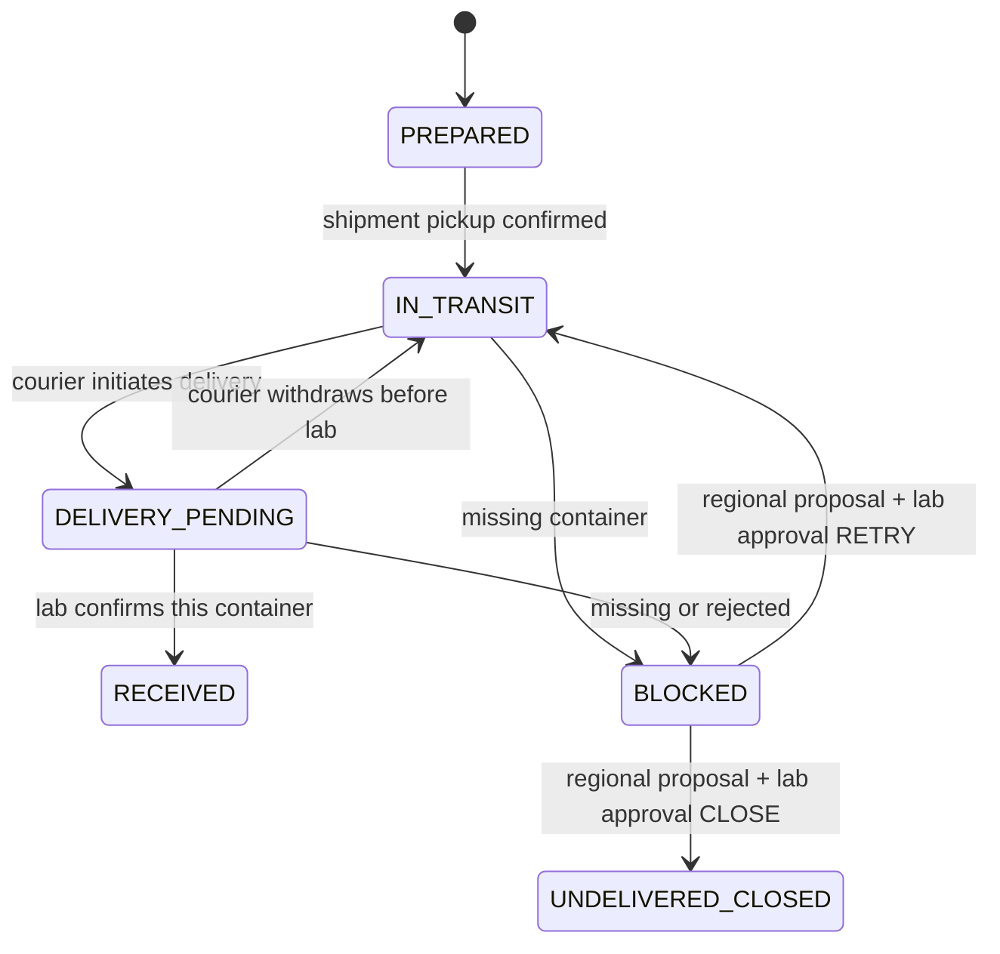
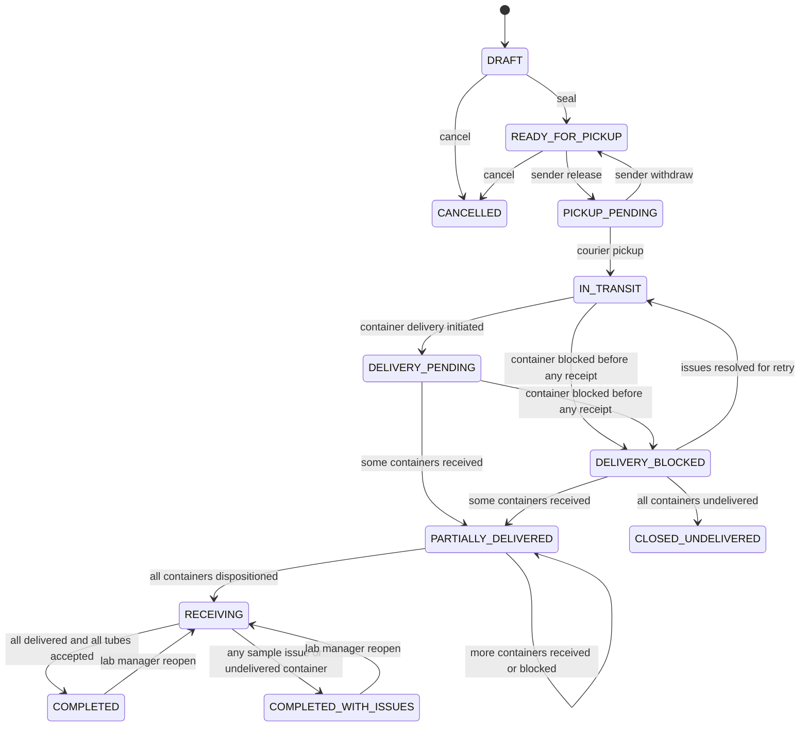

# LabTrack v0.6 — Автоматы состояний отправки, контейнера, ответственности и приёмки

> **Исторический базовый документ v0.6.** Противоречащие требования заменены версией v0.6.1; актуальные решения и API приведены в документах [Реестр решений v0.6.1](20-decisions-v061.md), [Исключения при передаче ответственности](21-custody-exceptions-v061.md), [Целостность автономных операций](22-offline-integrity-v061.md), [Изменения БД](23-data-model-v061.md), [API](24-api-and-operations-v061.md). Правила v0.6 сохраняются только там, где они не изменились.

**Нормативная спецификация процессов.** В [Реестре решений](15-decisions-v06.md) указано, что одобрил пользователь и какие технические правила являются производными. Все данные синтетические; юридического подписания и решений о клинической пригодности нет.

## 1. Границы агрегатов

Отправка объединяет один или несколько зафиксированных транспортных контейнеров, каждый с одним или несколькими образцами. **Отправка — агрегат транзакций и блокировок**, но **ответственность при доставке учитывается по транспортным контейнерам**; ни одна операция с контейнером не пропускает блокировку родителя.

- **Получение курьером:** одна двусторонняя передача на уровне отправки. Отправитель подтверждает выдачу → `PICKUP_PENDING`; назначенный курьер проверяет полный зафиксированный комплект и подтверждает получение → все контейнеры отправки переходят в `IN_TRANSIT`. Участники различаются. Переназначение курьера после DRAFT запрещено.
- **Доставка:** одна двусторонняя передача **для каждого контейнера**. Курьер инициирует доставку C-001 → C-001 `DELIVERY_PENDING`. Оператор лаборатории назначения подтверждает получение C-001 → C-001 `RECEIVED`. C-002 может оставаться `IN_TRANSIT` или `BLOCKED`. Для каждой передачи контейнера участники различаются; один участник может работать с несколькими контейнерами.
- **Приёмка пробирок:** лаборатория может отметить пробирку только если **её собственный родительский контейнер имеет статус `RECEIVED` с подтверждённой двусторонней передачей при доставке**. Выбор сканированием или вручную. Нельзя принимать элементы контейнера, который ещё в пути, ожидает подтверждения, заблокирован или закрыт без доставки.

Идентичность записей манифеста (отправка → контейнеры → элементы) остаётся неизменной после фиксации, даже при изменении статуса доставки отдельных контейнеров или результатов пробирок.

## 2. TransportContainer.delivery_status

| Состояние | Значение | Допустимый переход |
|---|---|---|
| `PREPARED` | Упакован до подтверждённого получения курьером | → IN_TRANSIT после завершённого получения |
| `IN_TRANSIT` | По данным системы ответственность несёт курьер | → DELIVERY_PENDING (инициирование курьером), → BLOCKED (сообщение MISSING) |
| `DELIVERY_PENDING` | Курьер инициировал доставку этого контейнера; лаборатория ещё не подтвердила | → RECEIVED (подтверждение лаборатории), → IN_TRANSIT (отзыв курьером), → BLOCKED (сообщение MISSING или REJECTED) |
| `RECEIVED` | Два разных участника подтвердили доставку **этого контейнера**; ответственность у лаборатории | Дальнейших переходов доставки в MVP нет; пробирки можно принимать |
| `BLOCKED` | Контейнер отсутствует или не принят; успешной доставки нет | → IN_TRANSIT после **одобренного** RETRY_DELIVERY; → UNDELIVERED_CLOSED после **одобренного** CLOSE_UNDELIVERED |
| `UNDELIVERED_CLOSED` | Региональные операторы и лаборатория вручную закрыли без успешной доставки | Окончательное состояние, результаты пробирок остаются NULL |

REJECTED для контейнера — решение лаборатории, которое следует заявлять в `DELIVERY_PENDING`; MISSING может заявить уполномоченный курьер или лаборатория из `IN_TRANSIT` или `DELIVERY_PENDING`. Отказ в приёмке контейнера следует отличать от отклонения пробирки при внутренней проверке успешно принятого контейнера.

Когда передача доставки PENDING прерывается состоянием BLOCKED, она становится WITHDRAWN (с участником, причиной и событием); последующий RETRY создаёт новый номер попытки для этого контейнера. Передачу CONFIRMED нельзя отозвать никогда.

### Передача отдельного контейнера (упрощённо)

## 3. Shipment.status (укрупнённый ход агрегата)

Статус отправки **не является** единственным источником данных об ответственности за отдельные контейнеры. Для допуска к приёмке пробирок всегда использовать `TransportContainer.delivery_status`.

До получения курьером сохраняется цепочка v0.5 `DRAFT → READY_FOR_PICKUP → PICKUP_PENDING → IN_TRANSIT` (либо отмена из DRAFT/READY_FOR_PICKUP и допустимый отзыв ожидающей выдачи).

После получения курьером вычислять **в следующем порядке приоритета** при каждом переходе контейнера:

1. Если уже есть завершённый сеанс приёмки и все контейнеры имеют окончательный исход, сохранять `COMPLETED` или `COMPLETED_WITH_ISSUES` до уполномоченного повторного открытия.
2. Если **все** контейнеры `UNDELIVERED_CLOSED`, перейти в окончательное `CLOSED_UNDELIVERED`; завершение приёмки невозможно.
3. Если **все** контейнеры `RECEIVED` или `UNDELIVERED_CLOSED` и **хотя бы один** RECEIVED, отправка имеет статус `RECEIVING`, пока лаборатория явно не завершит текущий сеанс приёмки.
4. Если **часть** контейнеров RECEIVED, а остальные ещё не завершены (IN_TRANSIT, DELIVERY_PENDING или BLOCKED), статус — `PARTIALLY_DELIVERED`, **даже при сеансе приёмки OPEN и наличии результатов пробирок**.
5. Если **ни один** не RECEIVED и **хотя бы один** контейнер BLOCKED, статус — `DELIVERY_BLOCKED`.
6. Если нет RECEIVED или BLOCKED и есть DELIVERY_PENDING, статус — `DELIVERY_PENDING`.
7. Иначе после получения курьером — `IN_TRANSIT`.

Таким образом, `PARTIALLY_DELIVERED` и `DELIVERY_BLOCKED` обозначают ход процесса, **а не блокировку всех незатронутых контейнеров**. API приёмки проверяет состояние получения конкретного контейнера и открытый сеанс.

Закрытие всех отсутствующих контейнеров без подтверждённой доставки даёт `CLOSED_UNDELIVERED`. Если хотя бы один контейнер успешно принят, отправку в итоге можно завершить как `COMPLETED_WITH_ISSUES`, когда остальные контейнеры получат окончательный исход, а каждая пробирка контейнеров RECEIVED — записанный результат. **Результаты пробирок для контейнеров UNDELIVERED_CLOSED не выдумываются.**

Диаграмма иллюстративная; **правила приоритета выше** определяют переходы, когда несколько контейнеров меняются в разном порядке (включая возврат из PARTIALLY_DELIVERED в тот же укрупнённый статус).

## 4. Проблема контейнера и двухэтапное разрешение

Категории проблем контейнера: `MISSING` и `REJECTED` (для обеих требуется подходящий код причины из начального каталога). Одна проблема OPEN на контейнер.

1. Курьер (MISSING) или оператор лаборатории назначения (MISSING/REJECTED) сообщает о проблеме контейнера IN_TRANSIT/DELIVERY_PENDING. Установить `container.delivery_status=BLOCKED`, сохранить проблему, отозвать попытку доставки PENDING, если она есть, добавить аудит. **Остальные контейнеры не меняются.**
2. REGIONAL_OPERATIONS региона отправки создаёт **предложение решения** для этой проблемы OPEN: `RETRY_DELIVERY` или `CLOSE_UNDELIVERED`, причина обязательна. Предложение имеет статус `PENDING` и **не влияет на ответственность**.
3. Другой пользователь `LAB_MANAGER` лаборатории назначения **одобряет** или **отклоняет** именно это предложение PENDING. Одобрение повторно проверяет статус проблемы, состояние контейнера, роль, участников, незавершённые попытки и применяет предложенный переход **атомарно с аудитом**. Отклонение оставляет контейнер BLOCKED, проблему OPEN; затем возможно новое предложение.
4. Одобренный RETRY разрешает проблему и переводит контейнер в IN_TRANSIT; следующая попытка доставки курьером будет новой. Одобренный CLOSE помечает проблему CLOSED_UNDELIVERED, а контейнер UNDELIVERED_CLOSED с долговечным хранением причины и истории.
5. Курьер не может подтвердить получение лабораторией; региональные операторы не могут одобрить собственное предложение даже при одновременном наличии LAB_MANAGER (разные ID пользователей). Это одобрение **отдельно от** двусторонней передачи при доставке.

**Физическая ответственность:** непринятый контейнер остаётся в ответственности курьера до вступления решения в силу. Одобренное административное закрытие не доказывает возврат; физический исход после закрытия остаётся вне MVP LabTrack.

## 5. Сеансы приёмки, результаты пробирок и повторное открытие

- Открыть первый `receiving_session(sequence=1,OPEN)` **при переходе первого контейнера в RECEIVED**.
- Оператор лаборатории может ставить `ACCEPTED`, `MISSING`, `REJECTED` каждому образцу любого контейнера RECEIVED. Для исключительного результата `reason_code` из начального каталога должен соответствовать области SAMPLE и виду результата. Каждое изменение добавляет `receipt_revision` + `audit_event`.
- Пробирки контейнера RECEIVED можно проверять, пока отправка ещё `PARTIALLY_DELIVERED`; **не** требовать Shipment.status=RECEIVING для изменения пробирки.
- `complete_receiving` требует **окончательного состояния каждого контейнера** (`RECEIVED` или `UNDELIVERED_CLOSED`), **хотя бы одного RECEIVED** и **ненулевого результата каждого элемента контейнеров RECEIVED**. Элементы недоставленных контейнеров остаются NULL.
- Окончательный результат: `COMPLETED`, если все контейнеры RECEIVED и все их пробирки ACCEPTED, иначе `COMPLETED_WITH_ISSUES`.
- LAB_MANAGER может повторно открыть COMPLETED или COMPLETED_WITH_ISSUES без ограничения по времени, указав причину. Новый сеанс OPEN, предыдущие сеансы и версии неизменны. Предыдущие текущие результаты сохраняются до явного исправления. Повторное открытие не позволяет менять зафиксированный манифест и ответственность за контейнеры.
- `CLOSED_UNDELIVERED` — окончательный статус без команды повторного открытия.

## 6. Совместимость с автономной работой курьера

Автономная команда получения представляет второе подтверждение получения **всей отправки**; она сканирует и сравнивает все коды зафиксированных контейнеров. Автономная команда доставки инициирует передачу **ровно одного контейнера** по ID/коду. У каждой стабильный `client_command_id`.

Любая ещё не синхронизированная команда локально имеет статус PENDING_SYNC и не влияет на ответственность на сервере. После 24 часов ожидания требуется рассмотрение; конфликт состояния сервера отклоняется без автоматического перебазирования. Применить команду можно только при действующей авторизации и допустимом текущем состоянии. Видны обе отметки времени — заявленная устройством и записанная сервером; авторитетна серверная отметка.

## 7. Приёмочные сценарии

1. Отправка из трёх контейнеров: C1 и C2 RECEIVED через отдельные двусторонние передачи, C3 BLOCKED REJECTED → отправка PARTIALLY_DELIVERED; результаты пробирок C1/C2 разрешены, C3 запрещены.
2. Региональный оператор предлагает CLOSE_UNDELIVERED для C3 → ответственность не меняется. Руководитель лаборатории одобряет → C3 UNDELIVERED_CLOSED, отправка RECEIVING. После явной обработки всех пробирок C1/C2 → COMPLETED_WITH_ISSUES.
3. Руководитель лаборатории отклоняет предложенный RETRY для C3 → C3 остаётся BLOCKED; возможно новое предложение, ложного события доставки нет.
4. Все контейнеры UNDELIVERED_CLOSED после одобрений → отправка CLOSED_UNDELIVERED; никогда не помечать как завершённую приёмку.
5. LAB_MANAGER повторно открывает завершённую смешанную отправку → новый сеанс; ранее UNDELIVERED_CLOSED пробирки нельзя принять; история версий сохранена.
6. Повтор точно такой же автономной команды курьера → тот же серверный результат; иное содержимое с тем же ID → конфликт без двойной передачи.

**Проверять это с блокировками PostgreSQL**, а не только модульными тестами автомата состояний.
