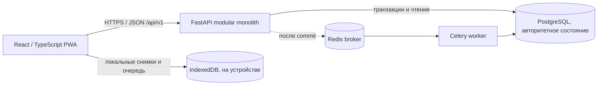

# Архитектура

LabTrack — модульный монолит FastAPI с PostgreSQL как источником бизнес-состояния. React/TypeScript/Vite PWA обращается к API под `/api/v1`; Redis и Celery обслуживают best-effort фоновые уведомления.

Пунктирная связь обозначает необязательную обработку уведомлений. Redis/Celery не подтверждают передачу и не заменяют состояние PostgreSQL.

## Backend

| Модуль | Ответственность |
|---|---|
| `identity`, `organizations` | Пользователи, активные membership grants, организации и справочные данные |
| `samples`, `shipments` | Пробирки, manifest, перевозки, handoffs и состояния контейнеров |
| `shipments.receiving`, `custody_incidents`, `container_issues`, `offline` | Результаты приемки, рассмотрение исключений и синхронизация команд Courier |
| `audit`, `idempotency` | История событий и безопасный повтор запросов |
| `operations`, `analytics`, `notifications` | Состояние зависших этапов, агрегаты и inbox |

API объединяет маршруты модулей в одном приложении. Авторизация перечитывает пользователя и его активные области доступа при запросе; проверки use case дополнительно связывают роль с нужной организацией, регионом и ресурсом.

## Клиент

Веб-клиент предоставляет отдельные рабочие области по ролям. В IndexedDB хранится Courier очередь и PHI-free снимки с областью пользователя. Токен остается в памяти; service worker кэширует shell приложения, а API-запросы отправляются в сеть.

## Границы достоверности

- PostgreSQL фиксирует бизнес-состояние и серверное время событий.
- Локальная команда без успешной синхронизации — предложение устройства, а не событие custody.
- Redis/Celery могут задержать или пропустить уведомление, не отменяя уже зафиксированную бизнес-команду.
- В репозитории нет полноценной актуальной ERD; проектные ограничения схемы изложены в [данных и целостности](data-and-integrity.md).

Код маршрутизации: [FastAPI v1 router](../backend/app/api/v1/router.py). Локальная настройка — в [руководстве разработки](development.md).
