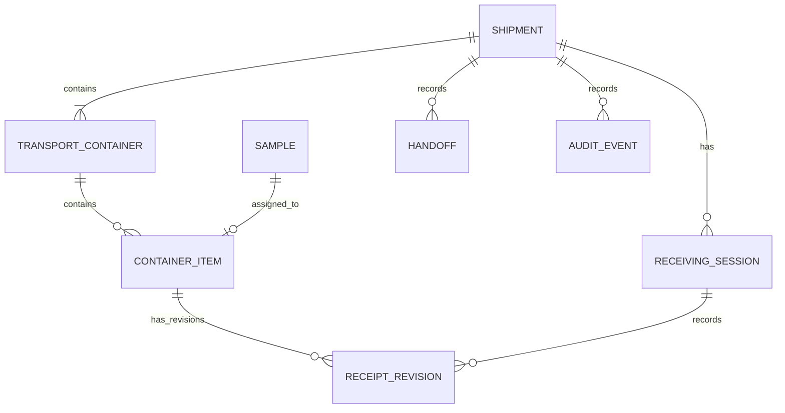

# Данные и целостность

PostgreSQL хранит авторитетное бизнес-состояние. Сервисные команды и ограничения схемы защищают переходы; Redis и браузерная очередь не являются источниками истины.

## Основные связи

`ContainerItem` — связующая запись между контейнером и пробиркой: каждая запись относится ровно к одному контейнеру и одной пробирке, а пробирка может не иметь такой записи или иметь не более одной. Это концептуальная схема, не полная ERD.

`Sample` представляет пробирку, а не пациента. Свободная ссылка на внешнюю ЛИС может быть идентифицирующей, поэтому реальную ссылку или пациентские данные нельзя помещать в публичный синтетический стенд.

## Инварианты

- При запечатывании manifest фиксирует набор контейнеров и пробирок; обычные операции не могут незаметно изменить его после seal.
- Pickup подтверждается для всей партии Sender и назначенным Courier как двумя разными участниками.
- Delivery и подтверждение Lab относятся к одному контейнеру. Получение одного контейнера не зависит от статуса остальных.
- Результат пробирки записывается только после подтвержденной приемки контейнера. Исправления оставляют историю revisions и audit.
- Результаты используют `ACCEPTED`, `MISSING` или `REJECTED`; для двух последних проверяется причина из соответствующего справочника.
- Запись команды, аудит, переход состояния и ответ для идемпотентного повтора фиксируются транзакционно. Конкурирующие изменения сериализуются блокировкой Shipment.
- Текущие активные grants и scope проверяются на сервере; старый токен не сохраняет отозванные роли.

Для исключительной приемки создается отдельное свидетельство: два сотрудника целевой лаборатории (включая менеджера) и региональное решение. Это не меняет подтверждение курьера и не принимает автоматически все пробирки.

Офлайн-идентификаторы и сроки replay описаны отдельно в [offline guide](offline-sync.md). Более подробная утвержденная модель — [v0.6.1 data model](23-data-model-v061.md); это проектная спецификация, а не актуальный ERD.
