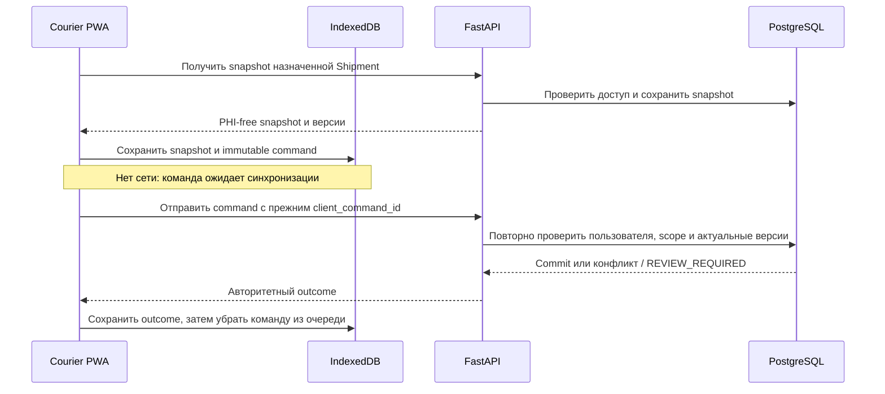

# Офлайн-синхронизация курьера

PWA курьера позволяет подготовить забор или доставку, когда устройство временно без сети. До ответа API команда остается локальной и не меняет состояние партии.

## Проверки при синхронизации

| Правило | Поведение |
|---|---|
| Снимок старше 24 часов | Сервер переводит команду в `REVIEW_REQUIRED`; устаревшее действие не применяется задним числом |
| Авторизация или назначение изменились | Сервер не применяет команду с отозванным доступом или неверным назначением |
| Изменилась релевантная версия манифеста, забора или целевого контейнера | Конфликт требует явного разбора; автоматического согласования версий нет |
| Повтор с тем же ID и содержимым запроса | Возвращается сохраненный подтверждённый сервером результат |
| Тот же ID с другим содержимым запроса | Повтор отклоняется |
| Срок хранения подробного результата повторного выполнения истёк | После 90 дней сохраняется запись-маркер, чтобы команда не применилась повторно |

Команда несет стабильный `client_command_id`. Клиент сохраняет ее до подтвержденного ответа и обрабатывает результаты последовательно. Два устройства имеют отдельные очереди; сервер проверяет состояние и не объединяет их автоматически.

Очередь в IndexedDB разделена по пользователю и установке браузера. Токен авторизации не сохраняется там; после перезагрузки нужно войти снова. При выходе/смене аккаунта интерфейс предупреждает об очистке данных этого пользователя. Служебный обработчик браузера хранит только оболочку приложения, API не обслуживается из кэша.

Подробные утвержденные правила: [офлайн-целостность v0.6.1](22-offline-integrity-v061.md). Обработчик работающего приложения: [offline.py](../backend/app/modules/shipments/offline.py), клиентское хранилище: [storage.ts](../web/src/storage.ts).
