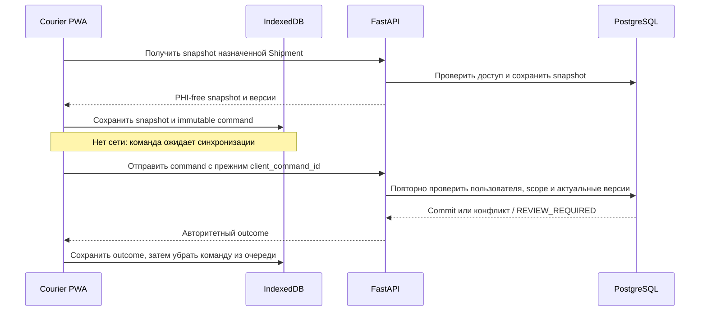

# Offline-синхронизация Courier

Courier PWA позволяет подготовить Pickup или Delivery, когда устройство временно без сети. До ответа API команда остается локальной и не меняет состояние Shipment.

## Проверки при синхронизации

| Правило | Поведение |
|---|---|
| Снимок старше 24 часов | Сервер переводит команду в `REVIEW_REQUIRED`; stale действие не применяется задним числом |
| Авторизация или назначение изменились | Сервер не применяет команду с отозванным доступом или неверным назначением |
| Изменилась релевантная версия manifest, Pickup или целевого контейнера | Конфликт требует явного разбора; автоматического rebasing нет |
| Повтор с тем же ID и payload | Возвращается сохраненный authoritative outcome |
| Тот же ID с другим payload | Повтор отклоняется |
| Детальный replay истек | После 90 дней сохраняется tombstone, чтобы команда не применилась повторно |

Команда несет стабильный `client_command_id`. Клиент сохраняет ее до подтвержденного ответа и обрабатывает результаты последовательно. Два устройства имеют отдельные очереди; сервер проверяет состояние и не объединяет их автоматически.

Очередь в IndexedDB разделена по пользователю и установке браузера. Токен авторизации не сохраняется там; после перезагрузки нужно войти снова. При выходе/смене аккаунта интерфейс предупреждает об очистке данных этого пользователя. Service worker хранит только shell, API не обслуживается из кэша.

Подробные утвержденные правила: [offline integrity v0.6.1](22-offline-integrity-v061.md). Runtime обработчик: [offline.py](../backend/app/modules/shipments/offline.py), клиентское хранилище: [storage.ts](../web/src/storage.ts).
