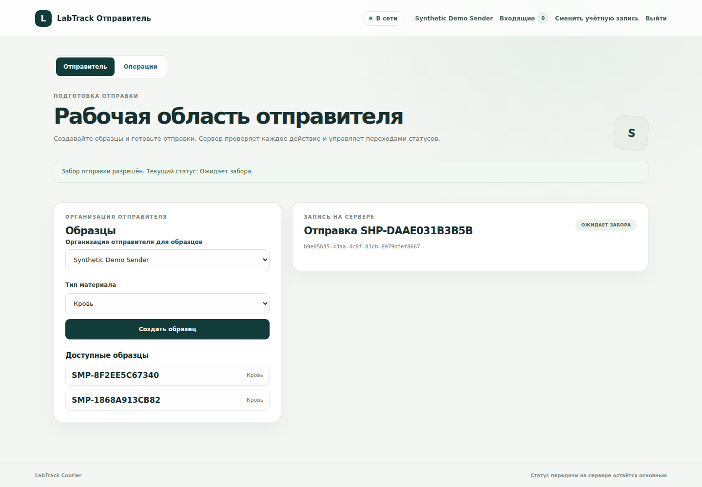
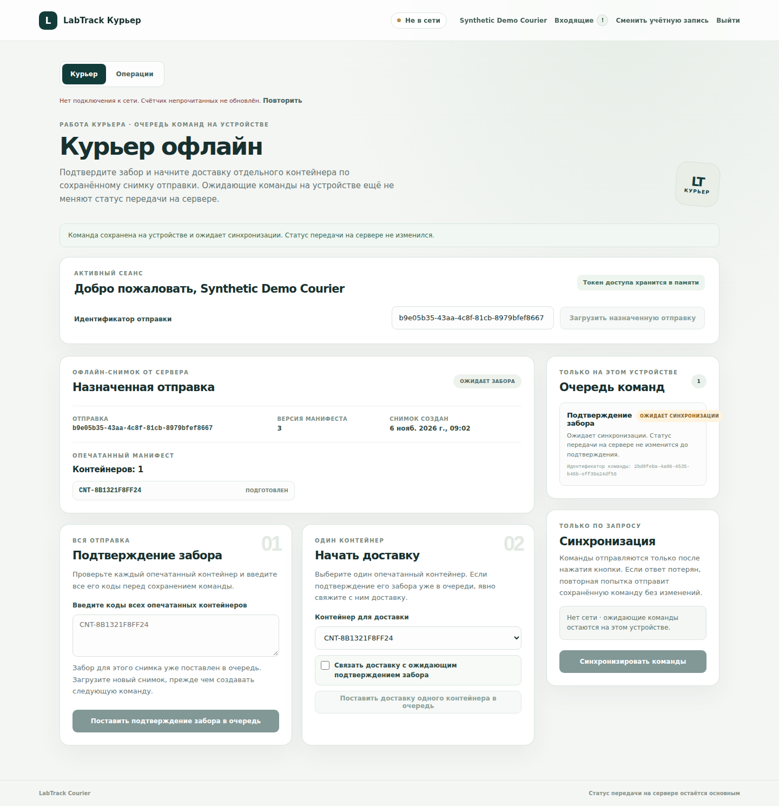
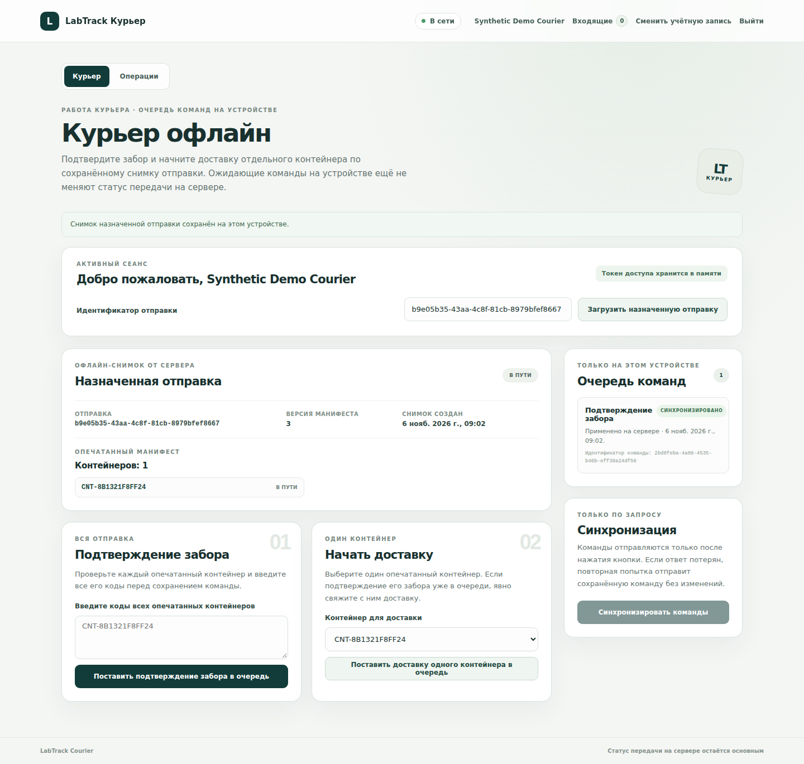
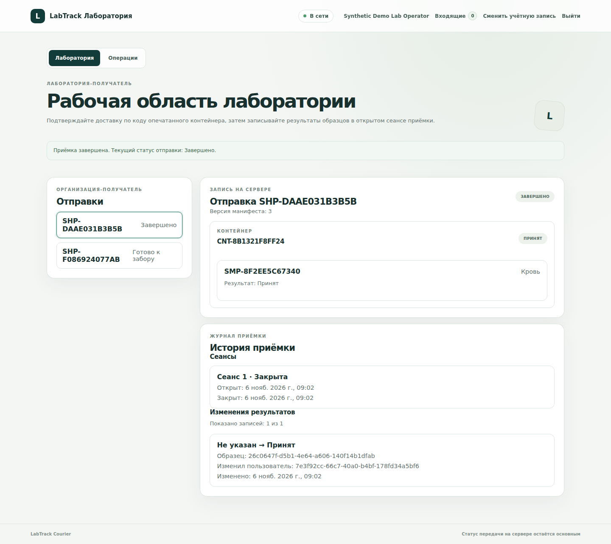

# Скриншоты интерфейса

Все четыре кадра сняты 2026-11-06 из реально запущенного локального интерфейса React/Vite и FastAPI с отдельной одноразовой PostgreSQL 15. Учётные записи и записи созданы специально для захвата; использованы только синтетические данные. Изображения — исходные полностраничные снимки без дорисовки и подмены интерфейса. UUID, коды контейнеров и образцов на них сгенерированы приложением.

## Отправитель разрешил забор

`PICKUP_PENDING` / «Ожидает забора» после действия отправителя.

## Курьер поставил забор в офлайн-очередь

Локальная команда `PENDING_SYNC`; серверный статус ещё `PICKUP_PENDING`.

## Сервер применил забор

Команда синхронизирована, API вернул `APPLIED`; свежий серверный снимок показывает `IN_TRANSIT` / «В пути».

## Лаборатория завершила приёмку

Контейнер принят, результат синтетической пробирки записан, партия имеет статус `COMPLETED` / «Завершено».

