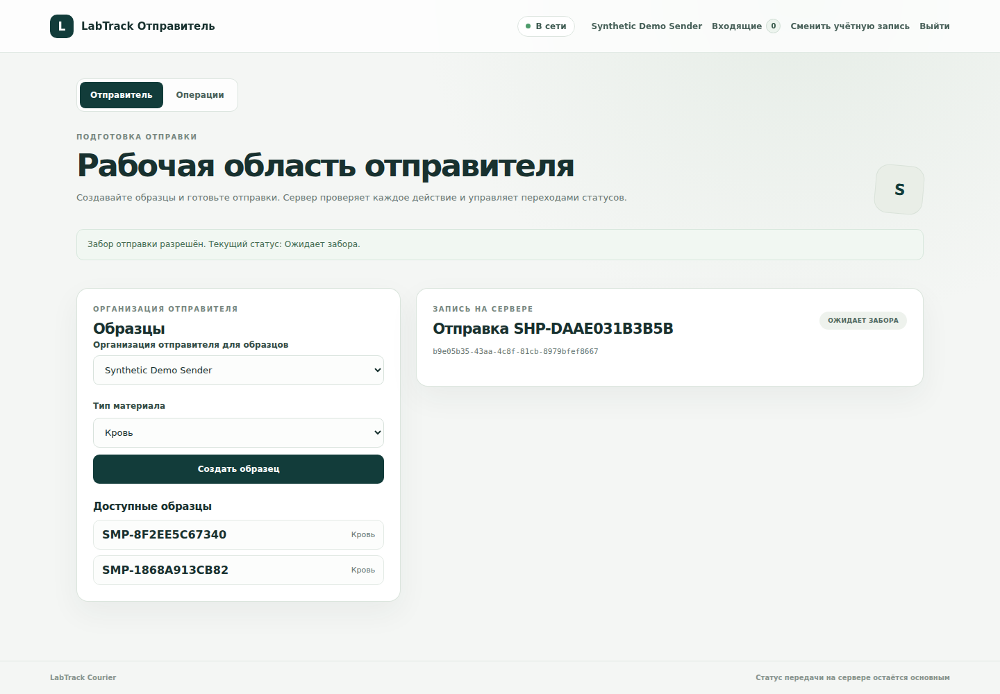
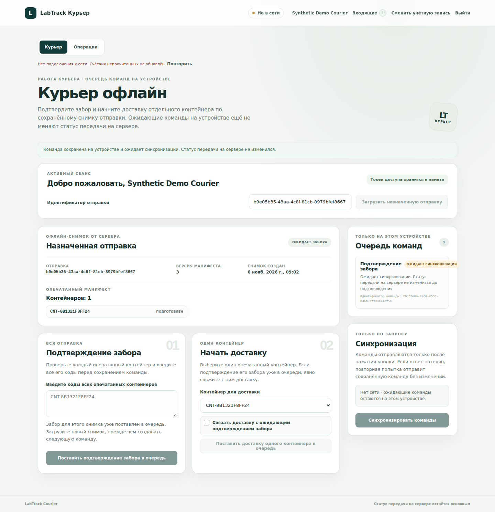
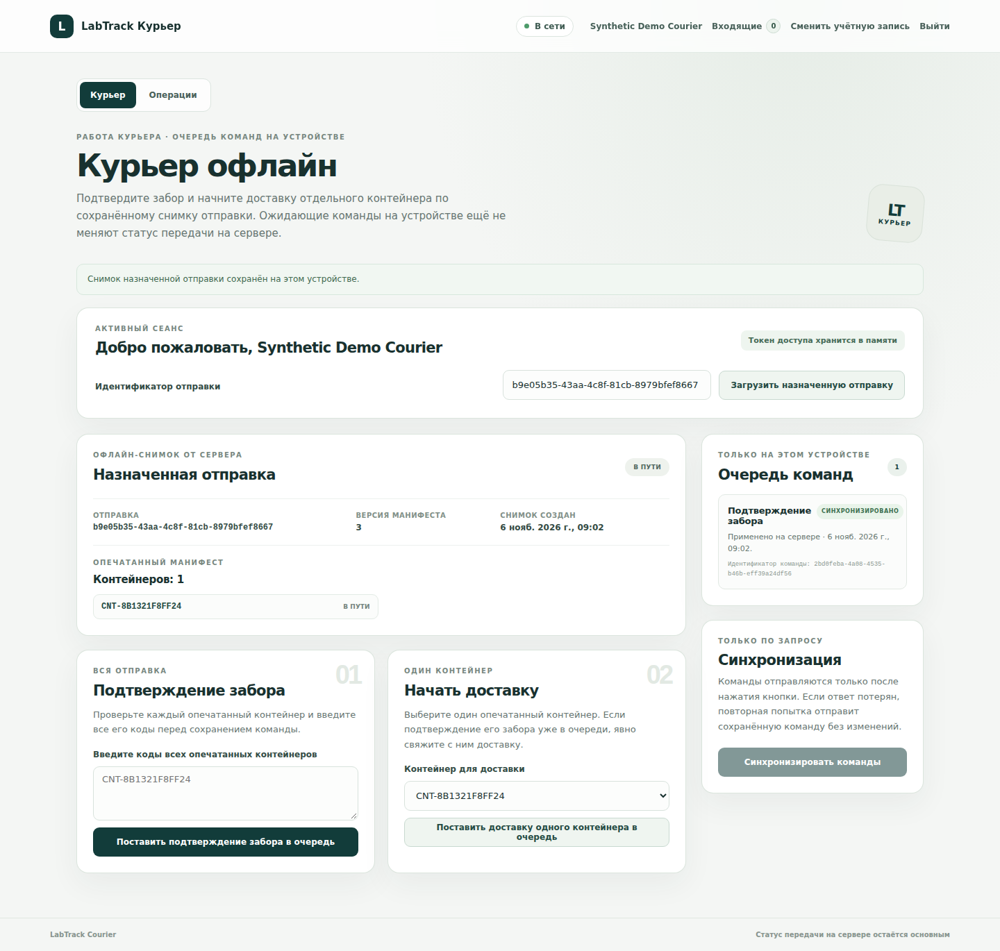
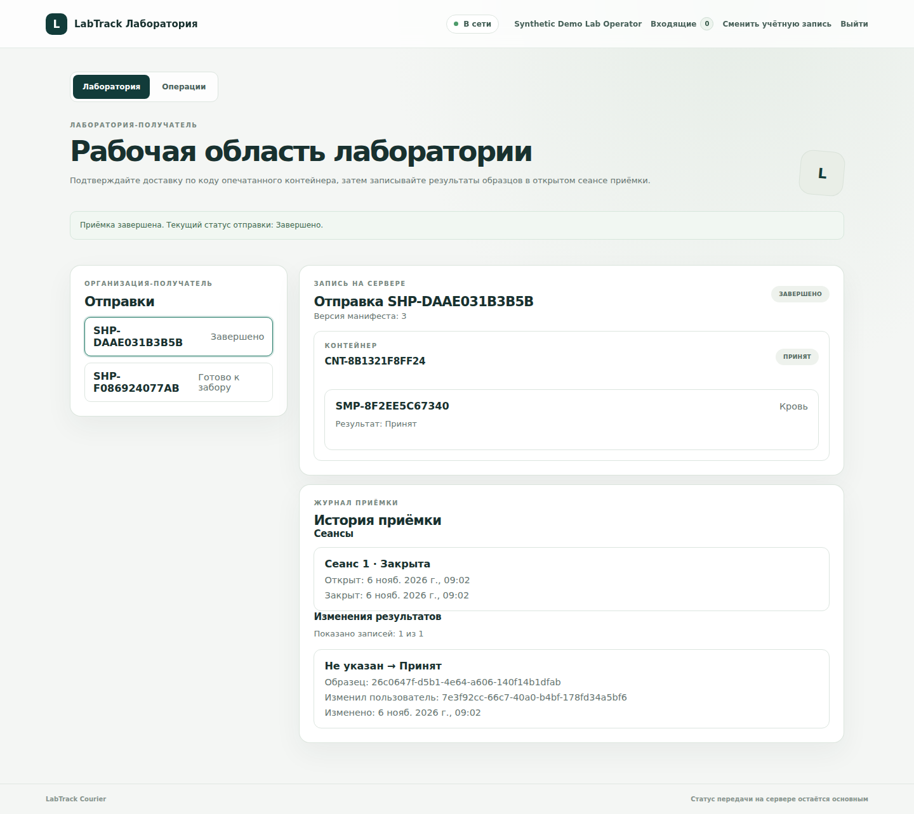

# Скриншоты интерфейса

Все четыре кадра сняты 2026-11-06 из реально запущенного локального React/Vite UI и FastAPI с отдельной одноразовой PostgreSQL 15. Учётные записи и записи созданы специально для захвата; использованы только synthetic-данные. Изображения — исходные full-page captures без дорисовки и подмены интерфейса. UUID, коды контейнеров и образцов на них сгенерированы приложением.

## Sender разрешил забор

`PICKUP_PENDING` / «Ожидает забора» после действия Sender.

## Courier поставил Pickup в offline-очередь

Локальная команда `PENDING_SYNC`; серверный статус ещё `PICKUP_PENDING`.

## Сервер применил Pickup

Команда синхронизирована, API вернул `APPLIED`; свежий серверный snapshot показывает `IN_TRANSIT` / «В пути».

## Lab завершила приёмку

Контейнер принят, synthetic sample result записан, Shipment имеет статус `COMPLETED` / «Завершено».

