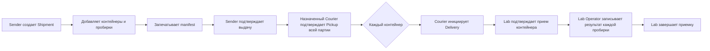

# Рабочие процессы

Основной объект — `Shipment`: партия отправленных пробирок. Каждая пробирка — `Sample`; партия содержит один или несколько `TransportContainer`, каждый из которых содержит пробирки.

## Обычная передача

Подтверждения Pickup должны сделать разные пользователи. После Pickup обычный Delivery проходит отдельно по каждому контейнеру, поэтому лаборатория может обработать уже полученные контейнеры, пока остальные еще в пути.

| Участник | Граница полномочий | Основные действия |
|---|---|---|
| `SENDER_OPERATOR` | Организация-отправитель | Создать и запечатать партию, подтвердить выдачу |
| `COURIER` | Регион и назначение на Shipment | Подтвердить Pickup, инициировать Delivery контейнера |
| `LAB_OPERATOR` | Целевая лаборатория | Подтвердить контейнер, внести результат пробирки |
| `LAB_MANAGER` | Целевая лаборатория | Действия Lab Operator, завершение и повторное открытие приемки |
| `REGIONAL_OPERATIONS` | Регион | Рассмотрение инцидента и отдельные административные решения |
| `REGIONAL_ANALYST` | Регион | Чтение разрешенных агрегатов |

Роль сама по себе не дает доступ к любому объекту: backend проверяет активный grant и его организационную или региональную область.

## Исключительная приемка

Если контейнер физически предъявлен, но курьер не может подтвердить обычную передачу, региональный оператор открывает рассмотрение. Исключительная приемка возможна только после подтвержденного whole-Shipment Pickup и двух отдельных свидетельств сотрудников целевой лаборатории; один из них должен иметь активную роль `LAB_MANAGER`. Региональный оператор отдельно принимает решение и не считается свидетелем или курьером.

Инцидент не превращается в подпись отсутствующего участника. Если условия не соблюдены, контейнер остается неполученным. Для проблем с контейнером используются только `MISSING` и `REJECTED`; инцидент является административным рассмотрением, а не третьим видом расхождения.

## Результат лаборатории

Lab Operator отмечает результат каждой пробирки только после подтвержденной приемки ее контейнера. Менеджер может завершить приемку, когда обработаны полученные пробирки и определен итог по контейнерам; `LAB_MANAGER` может открыть новую сессию с причиной, сохраняя историю предыдущих изменений.

Поведение описано в `backend/app/modules/shipments/` и [API guide](api.md). Утвержденные подробные правила: [исключения v0.6.1](21-custody-exceptions-v061.md).
